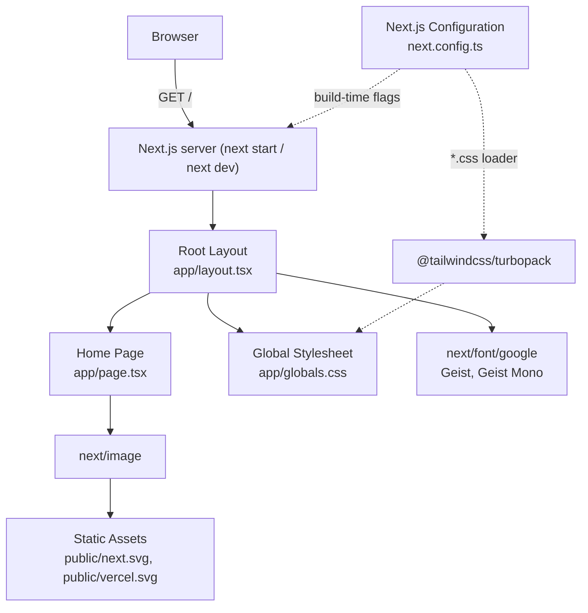
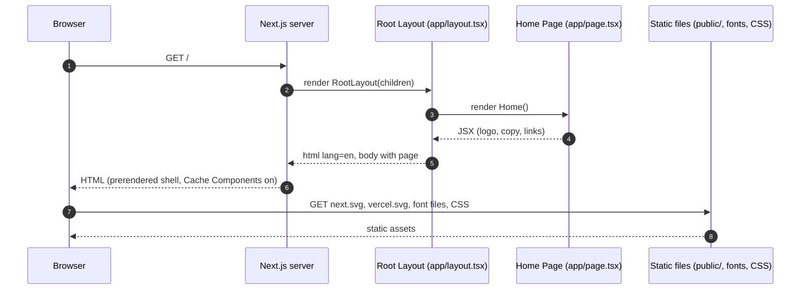
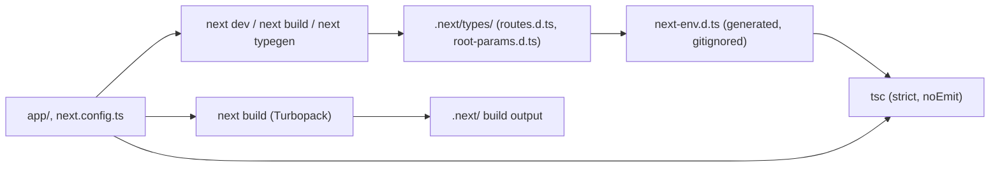

# Architecture — hospital-bill-audit-app

## Architecture Analysis

### System Overview

A single Next.js 16.4.3 App Router application (React 19.3.0, TypeScript strict, Tailwind CSS 4.3.3), built and served by the Next.js CLI with Turbopack. The application currently consists of one root layout and one static page. There is no server-side logic, no API surface, no data store and no external integration at runtime.

### Architectural Style

**Single-deployable web monolith (framework-default App Router), currently static.** Evidence:

- One package, no workspaces (`package.json`).
- One route, `/`, confirmed by generated `.next/types/routes.d.ts` (`AppRoutes = "/"`).
- Both modules are React Server Components (no `"use client"`, no `"use server"`).
- No `route.ts`, `proxy.ts` / `middleware.ts`, `instrumentation.ts`, or data-access code.

There is no domain layering, bounded context or module boundary yet. The dominant "architecture" is the Next.js file-system convention itself. Deployment topology (monolith vs. split services) has not been decided and belongs to Units Generation.

### Component Relationships

Text fallback: the browser requests `/`; the Next.js server renders the Root Layout (`app/layout.tsx`), which loads the Global Stylesheet and the Geist fonts and wraps the Home Page (`app/page.tsx`). The Home Page renders two images from `public/` through `next/image`. `next.config.ts` sets build-time flags and routes every CSS file through the `@tailwindcss/turbopack` loader. There are no other components.

### Data Flow

There is no application data. The only flows are:

1. **Request flow:** browser → Next.js server → prerendered/server-rendered HTML for `/` → browser (see Interaction Diagrams).
2. **Build-time asset flow:** `next/font/google` downloads Geist and Geist Mono at build time and self-hosts them; `app/globals.css` is processed by Tailwind v4 through the Turbopack loader.
3. **Outbound navigation:** plain `<a>` links to vercel.com and nextjs.org with `utm_*` parameters (user-initiated, not server calls).

No user input is accepted, stored or transmitted.

## Interaction Diagrams

The codebase implements no business transaction. The only end-to-end interaction is serving the home page. It is shown so that later stages can see where new transactions (upload, check, report) will attach.

### Serving `GET /`

Text fallback: (1) the browser sends `GET /`; (2) the server renders the Root Layout; (3) the layout renders the Home Page; (4-5) the page returns static JSX into the layout's `<html lang="en">` and `<body>`; (6) the server returns HTML, prerendered because the page uses no dynamic data and Cache Components is on; (7-8) the browser fetches the SVGs, self-hosted fonts and CSS.

### Build and type-generation flow

Text fallback: `next dev`, `next build` or `next typegen` generate `.next/types/` and `next-env.d.ts`; only after that can `tsc` type-check `app/layout.tsx`, which uses the global `LayoutProps<"/">`. `next build` (Turbopack) produces the build output. Neither the generated types nor `next-env.d.ts` are committed.

### Key Design Decisions

These are inherited from the scaffold and its configuration, not deliberate product decisions. Each still constrains design.

| Decision (as found) | Location | Implication |
|---|---|---|
| App Router with Server Components by default | `app/` | New product screens are Server Components unless marked `"use client"`; mutations will use Server Actions or Route Handlers. |
| `cacheComponents: true` | `next.config.ts:8` | The Cache Components model (`use cache`, `cacheLife`) is active. **Per-session, anonymous, uploaded-bill data must never fall into a shared `use cache` scope**; it must stay request-scoped or in per-session storage. The docs say this becomes unconditional in the next major. |
| `partialPrefetching: true` | `next.config.ts:9` | Staged navigation/prefetch. Pages showing a user's bill or findings must not be prefetched or prerendered with user data. |
| `experimental.agentFeedback: true` | `next.config.ts:5-7` | Needs Next.js Telemetry on; `next dev` writes a managed block into `AGENTS.md`. Reports are documented as anonymised, but for a medical-bill product keeping telemetry on must be a **conscious privacy and compliance decision** (DPDP Act from day one). |
| Tailwind v4 via the `@tailwindcss/turbopack` loader, no PostCSS config | `next.config.ts:10-17` | CSS processing is tied to Turbopack; a webpack build would lose Tailwind. Low risk, record it. |
| Request interception file name | Next 16 convention | `middleware` is renamed `proxy`; any security headers or request gating design should target `proxy.ts`. |
| Path alias `@/*` → `./*` | `tsconfig.json` | Root-relative imports are ready; there is no `src/` directory. |

### Security and Compliance Notes

- No hard-coded secrets; `.mcp.json` reads `${CONTEXT7_API_KEY}` from the environment; `.env*` is gitignored.
- No security headers, no `proxy.ts`, no error boundaries (`error.tsx`, `not-found.tsx`), no input handling. All are greenfield work.
- Telemetry (above) and caching (above) are the two existing settings with privacy impact.
- Hosting is a working assumption (Vercel), not a decision; there is no `vercel.json` or deployment config. Data-residency and hosting decisions (feasibility F2, F3) will shape where uploads, logs and caches live.

### Improvement Opportunities

1. Decide telemetry and `agentFeedback` explicitly before any real bill touches the app.
2. Establish an explicit caching rule for user data under Cache Components (request-scoped only, no shared cache) in NFR Design.
3. Introduce module boundaries when product code arrives (for example UI, bill-intake, checks engine, report generation, internal tools), with adapters around third-party bill readers. Deciding these is Domain Design's job.
4. Add `proxy.ts` for security headers, plus `error.tsx` / `not-found.tsx`.
5. Make type generation an explicit CI step (`next typegen`) before `tsc`.

## Sources

- Developer scan: `aidlc/spaces/default/intents/261026-bill-audit-baseline/inception/reverse-engineering/developer-scan.md` (Build System, APIs Discovered, Technical Debt Signals, Handoff Summary).
- Code confirmed by the architect: `app/layout.tsx`, `app/page.tsx`, `app/globals.css`, `next.config.ts`, `package.json`.
- Generated (not source): `.next/types/routes.d.ts`, `next-env.d.ts`.
- Next.js docs bundled in `node_modules/next/dist/docs/` as cited in the scan (Cache Components, `partialPrefetching`, `agentFeedback`, `middleware` to `proxy` rename).
- Hosting status: `aidlc/spaces/default/memory/project.md` `## Corrections`.

## Assumptions & Open Questions

- Assumption: Cache Components prerenders `/` as a static shell because the page uses no dynamic APIs; this was not verified with `next build` (the scan did not run a build).
- Open: whether Next.js telemetry and `experimental.agentFeedback` stay enabled is a product privacy decision for the founder, to be settled in NFR Requirements at the latest.
