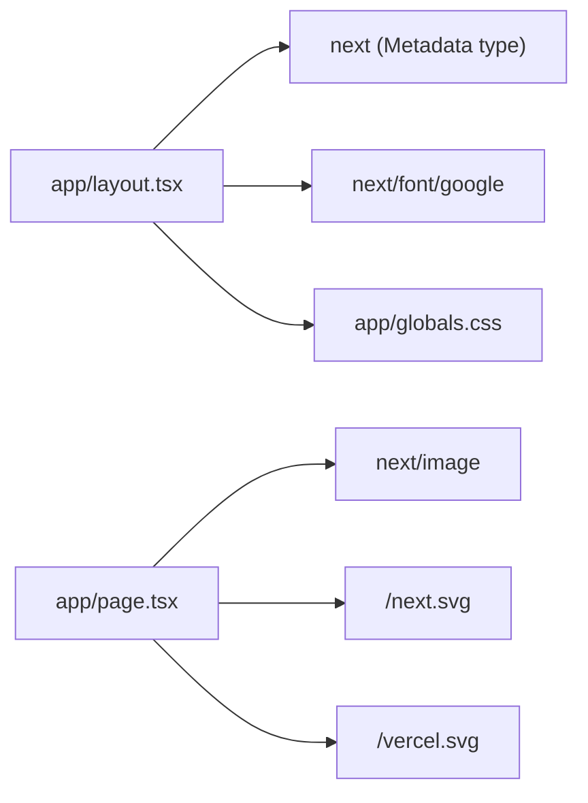

# Code Structure — hospital-bill-audit-app

## Repository Layout

```text
hospital-bill-audit-app/
├── app/                    # Next.js App Router (application code)
│   ├── layout.tsx          # Root layout (Server Component)
│   ├── page.tsx            # Home page "/" (Server Component, template)
│   ├── globals.css         # Tailwind v4 entry + CSS variables
│   └── favicon.ico         # Default favicon (binary)
├── public/                 # Static assets served from "/"
│   ├── next.svg, vercel.svg            # used by app/page.tsx
│   └── file.svg, globe.svg, window.svg # unused template leftovers
├── next.config.ts          # Next.js config (flags + Turbopack CSS rule)
├── tsconfig.json           # TypeScript strict, alias @/* -> ./*
├── eslint.config.mjs       # ESLint 9 flat config (Next presets)
├── package.json            # scripts + dependencies
├── package-lock.json       # npm lockfile v3 (437 entries)
├── .nvmrc                  # v24.19.0
├── .gitignore              # Next.js ignores + AI-DLC managed block
├── .mcp.json               # MCP servers for AI tooling (not app code)
├── aidlc.settings.json     # AI-DLC model preset (not app code)
├── README.md               # Unmodified Create Next App README
├── AGENTS.md, CLAUDE.md    # Agent instructions (CLAUDE.md = @AGENTS.md)
├── next-env.d.ts           # Generated, gitignored, NOT tracked
├── .next/types/            # Generated route types, gitignored
├── PRDs/                   # Product document (not app code)
├── .claude/                # AI-DLC tooling (91 .ts/.js files, not app code)
└── aidlc/                  # AI-DLC workspace (memory, intents, knowledge)
```

There is no `src/`, `components/`, `lib/`, `tests/` or `e2e/` directory.

## File Classification (application code)

| File | Category | Notes |
|---|---|---|
| `app/layout.tsx` | Layout / configuration (Server Component) | Loads Geist and Geist Mono (`next/font/google`), imports `globals.css`, renders `<html lang="en">`. Template metadata at lines 15-18. Uses the global generated type `LayoutProps<"/">` (line 20). |
| `app/page.tsx` | Page / static (Server Component) | Template content and four outbound links with `utm_*` parameters. No state, no data fetching. |
| `app/globals.css` | Stylesheet | `@import "tailwindcss"`; `--background` / `--foreground` with a dark-mode override; `@theme inline` mapping to Tailwind tokens and Geist fonts. The `body` rule sets `font-family: Arial, Helvetica, sans-serif`, overriding the Geist font configured in the layout. |
| `app/favicon.ico` | Asset | Default. |
| `public/*.svg` | Assets | 2 used, 3 unused. |

Configuration files are described in `technology-stack.md`; non-application areas in `component-inventory.md`.

## Module Dependency Graph (internal)



Text fallback: `app/layout.tsx` imports `next`, `next/font/google` and `./globals.css`; `app/page.tsx` imports `next/image` and references `/next.svg` and `/vercel.svg`. `app/page.tsx` is mounted by the framework as the layout's `children`, not imported. No circular references; no `@/*` alias imports yet.

## Code Patterns Observed

- **File-system routing** (App Router): one `page.tsx` per route segment; one root `layout.tsx`.
- **Server Components by default**: no `"use client"` boundaries.
- **Route-aware global types**: `LayoutProps<"/">` comes from generated `.next/types/`, not an import.
- **Utility-first styling**: Tailwind classes inline in JSX, CSS-first theme in `globals.css`; no `tailwind.config.*`.
- **Formatting**: Create Next App style (2-space indent, double quotes, semicolons); no Prettier or `.editorconfig`.
- **Naming**: idiomatic (PascalCase components `RootLayout`, `Home`; camelCase variables).

Absent patterns relevant to the intended product: no Server Actions, Route Handlers, error/loading/not-found boundaries, validation schemas, data access, or client components.

## Sources

- Developer scan: `aidlc/spaces/default/intents/261026-bill-audit-baseline/inception/reverse-engineering/developer-scan.md` (Packages Found, file classification table, dependency graph).
- Code confirmed by the architect: `app/layout.tsx`, `app/page.tsx`, `app/globals.css`; `git ls-files` and `git check-ignore -v next-env.d.ts` run on 2026-11-04.

## Assumptions & Open Questions

None.
