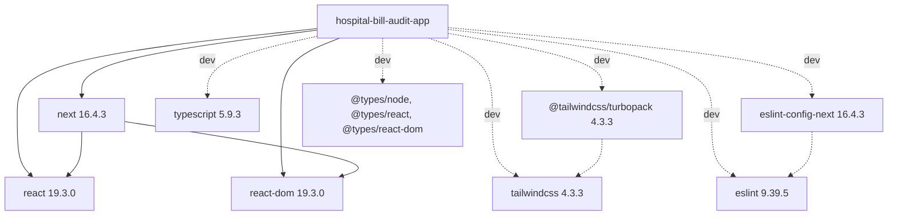

# Dependencies — hospital-bill-audit-app

## Runtime Dependencies (`dependencies`)

| Package | Version | Pin style | Why |
|---|---|---|---|
| next | 16.4.3 | exact | Framework |
| react | 19.3.0 | exact | UI |
| react-dom | 19.3.0 | exact | Rendering |

## Development Dependencies (`devDependencies`)

| Package | Declared | Installed | Why |
|---|---|---|---|
| @tailwindcss/turbopack | ^4 | 4.3.3 | Tailwind loader for Turbopack |
| tailwindcss | ^4 | 4.3.3 | CSS framework |
| typescript | ^5 | 5.9.3 | Type checking |
| eslint | ^9 | 9.39.5 | Linting |
| eslint-config-next | 16.4.3 | 16.4.3 | Next lint presets, version-locked to `next` |
| @types/node | ^20 | 20.19.43 | Node typings |
| @types/react | ^19 | 19.3.0 | React typings |
| @types/react-dom | ^19 | 19.3.0 | React DOM typings |

The lockfile (`package-lock.json`, v3) resolves 437 packages in total. Caret ranges on dev dependencies are reproducible through the lockfile; `npm ci` should be used in CI.

## Dependency Graph

Text fallback: the app depends at runtime on `next`, `react` and `react-dom` (Next itself peers on React). Dev-only: `tailwindcss` with its Turbopack loader, `typescript`, `eslint` with `eslint-config-next`, and the three `@types/*` packages.

## External Services

| Service | Kind | When | Status |
|---|---|---|---|
| Google Fonts | Build-time download (via `next/font/google`) | Build/dev | In use; self-hosted at runtime |
| Next.js Telemetry | Dev tooling telemetry | `next dev` (required by `experimental.agentFeedback`) | Enabled by config; privacy decision pending |
| context7 MCP | AI tooling (`.mcp.json`, `${CONTEXT7_API_KEY}`) | Agent sessions only | Not an app dependency |
| Hosting platform | — | — | Not decided (Vercel working assumption) |

No databases, queues, storage buckets, OCR/AI services or payment providers.

## Internal Cross-Package Dependencies

None. Single package, no workspaces. Within the package: `app/layout.tsx` → `app/globals.css`; `app/page.tsx` → `public/next.svg`, `public/vercel.svg` (see `code-structure.md`).

## Dependency Risks

- **Node engine:** Next 16 needs Node ≥20.9.0; no `engines` field enforces `.nvmrc`'s v24.19.0; the machine default is v18.12.1.
- **`@types/node ^20` vs Node 24:** minor typing mismatch.
- **Tailwind via Turbopack loader only:** no PostCSS fallback; differs from the bundled Next CSS guide (`@tailwindcss/postcss`).
- **Version lockstep:** `eslint-config-next` is pinned to `next`'s version; upgrade both together.

## Sources

- Developer scan: `aidlc/spaces/default/intents/261026-bill-audit-baseline/inception/reverse-engineering/developer-scan.md` (Frameworks & Libraries, Build System, APIs Discovered).
- Code: `package.json`, `package-lock.json` (header and count), `.nvmrc`, `.mcp.json`, `next.config.ts`.

## Assumptions & Open Questions

None.
