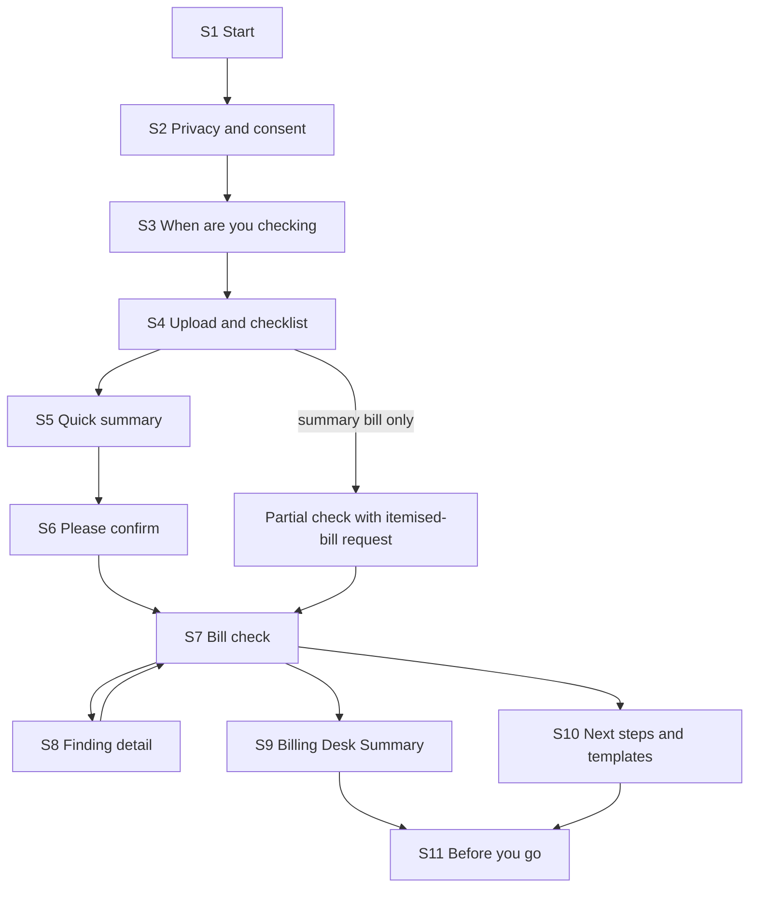

# User Flow — Hospital Bill Check (Project RS, Phase 1)

This document describes the core user flow and the information layout for the screens in `wireframes.md`. It follows:

- the approved intent statement (`intent-statement.md`);
- the scope in `scope-document.md` and `intent-backlog.md` (`ideation/scope-definition/`).

## Sources

- [Q1]–[Q5]: answers in `rough-mockups-questions.md` in this folder.
- PRD journey J1 (§11.2) and requirements ON, SD, CM, DU, RE, RP, AD and FB in `PRDs/app-baseline.md`.
- Screen IDs S1–S11 refer to `wireframes.md`.

## 1. Core flow (happy path)

```
Flow: Hospital Bill Check
Persona: a family member at discharge (e.g. "Priya"), or any primary persona
Trigger: the hospital hands over an interim or final bill, or the bill is already paid
Steps:
  1. S1 Start          -> taps "Check my bill"     -> privacy summary shown
  2. S2 Consent        -> picks relationship, ticks
                          both boxes, "Continue"   -> moment choice shown
  3. S3 Moment         -> picks "At discharge"     -> checklist tailored to discharge
  4. S4 Upload         -> adds bill photos/PDFs    -> checklist ticks; prompts for
                                                      missing or unclear pages
  5. S5 Quick summary  -> waits, reads summary     -> total, balance due, biggest
                                                      items, first flags (minutes)
  6. S6 Confirm        -> confirms case details
                          and unclear lines        -> full check runs
  7. S7 Bill check     -> reads Breakdown, Top 3   -> findings listed by class
  8. S8 Finding        -> marks "Will ask"         -> added to the summary
  9. S9 Desk Summary   -> shows it at the desk     -> one page, "please correct" first
 10. S10 Next steps    -> copies a letter if needed-> templates and escalation ladder
 11. S11 Before you go -> downloads the PDF,
                          answers consent choice   -> session ends; nothing
                                                      identifying is kept
Success outcome: the family leaves with a report and 2-3 precise, polite questions for
                 the billing desk
```



Text version of the diagram:

- Start → consent → choose the moment → upload → quick summary → confirm → bill check.
- From the bill check, the user can open a finding and come back, open the Billing Desk Summary, or open next steps. Both of those lead to "Before you go".
- If only a summary bill is uploaded, a partial check runs, with a request for the itemised bill, and then goes to the bill check.

## 2. Variations by moment

| Moment (S3) | What changes |
|---|---|
| In hospital (interim bill) | Each interim bill is its own session; nothing carries over (PRD D7). The checklist asks for the interim bill only. The actions focus on questions to ask now |
| At discharge (final bill) | The full checklist, including the discharge summary for consistency checks. The Billing Desk Summary is the main action |
| Already paid | The checklist adds payment receipts. S10 leads with the revised-bill and refund request (PRD §11.2 stage 7) |

The remote family manager ("Meera") runs the same flow on a laptop, from photos forwarded to her, and forwards the PDF back to the family (PRD §9.1). The desktop layout is designed equally for this [Q2].

## 3. Error and edge paths

| Where | Condition | What the user sees | Recovery |
|---|---|---|---|
| S2 | A box is not ticked | "Continue" stays disabled, with a text reason | Tick the box |
| S4 | Blurry or cut-off page | "Page 2 is blurry. Please retake it." (DU-07) | Retake that page only |
| S4 | Missing page | "Page 3 of 7 seems missing." (DU-06) | Add the page, or continue and accept a partial check |
| S4 | Summary bill only | "This looks like a summary bill." (DU-08) | Get the request letter; continue with a partial check |
| S4 | Weak network | Per-file progress; "We'll keep trying" | Uploads resume within the session (NFR-12) |
| S4 | Password-protected PDF | Password field (DU-09) | Enter the password; it is not stored |
| S6 | Lines in Hindi or regional scripts | "Not read" against each line (DP-08) | Skip or type the line in |
| S7 | No findings | "We found nothing that looks wrong", with what was checked | Download the report |
| S7 | Complex or clinical finding | "Complex — consider professional advice" | No expert in Phase 1; the report says so |
| Any | Inactivity | Warning before the session ends (SD-08; time set later) | "I'm still here" |
| Any | Session ended | "Your documents were deleted. You can start again." | Start again |
| S11 | User leaves without downloading | A clear prompt that the report cannot be retrieved later (SD-07) | Download before leaving |
| Any | User wants to stop | "Discard everything now" (ON-07) | Data is removed in the session |

## 4. Information layout

The product is a single linear session, not a site with menus. Navigation is the step indicator "Upload → Review → Report" plus "Back" (PRD CM-03).

```
Session (one case)
├── Start (S1)
├── Privacy and consent (S2)
├── When are you checking (S3)
├── Upload: documents and checklist (S4)
├── Review
│   ├── Quick summary (S5)
│   └── Please confirm (S6)
└── Report
    ├── Bill check: Breakdown, Top 3, findings (S7)
    │   └── Finding detail (S8)
    ├── Billing Desk Summary (S9)
    ├── Next steps and templates (S10)
    └── Before you go: download, consent, feedback (S11)
```

Information priority on the bill check (S7), from top to bottom:

1. The total billed.
2. The Bill Breakdown by class.
3. The Top 3 actions.
4. The findings list, with low-confidence items collapsed.
5. The Billing Desk Summary and download.

This follows the PRD's "short list, objective errors first" rule for the billing desk (§9.3).

## Assumptions & Open Questions

- The flow assumes the bill reader returns the quick summary within the speed targets (`intent-statement.md`). Whether it can is tested by the bill-reading trial (`intent-backlog.md`, WP-00).
- Whether the step indicator also needs a "start again" shortcut is left for Refined Mockups.
