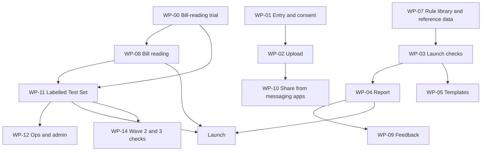

# Intent Backlog — Hospital Bill Check (Project RS, Phase 1)

This is the prioritised list of work packages for this build. It follows the boundary in `scope-document.md`, the intent statement (`intent-statement.md`), and the feasibility findings (`feasibility-assessment.md`, `constraint-register.md`).

Each package is a rough grouping of PRD features. The real units of work are designed later, in Inception.

## Sources

- [Q1]–[Q8]: answers in `scope-definition-questions.md` in this folder.
- PRD M-n / S-n / requirement IDs: `PRDs/app-baseline.md` §12, §15.
- **Priority:** MoSCoW, as in the PRD [Q1].
- **Order:** value first, with the bill-reading trial first and the reader-independent features built alongside it [Q5] [Q8].
- **Depends on bill reader:** "No" means the package can be built before the bill-reading trial picks an option [Q8].

## Backlog

| Order | ID | Work package | PRD features | Priority | Depends on bill reader | Depends on | Notes |
|---|---|---|---|---|---|---|---|
| 1 | WP-00 | **Bill-reading trial** on synthetic bills, measuring accuracy, speed and cost per audit; later repeated on real bills | Feasibility F1; `build-vs-buy.md` | Must (gate) | — | — | First piece of work [Q8]. Its synthetic bills also seed the Labelled Test Set |
| 2 | WP-01 | **Entry, consent and session**: anonymous entry, privacy notice, granular consent, single-session case, session expiry, download prompt | M1, M2, M17, M16 | Must | No | — | Built alongside WP-00 |
| 3 | WP-02 | **Upload and capture guidance**: PDFs and photos of all document types; summary-vs-itemised detection; itemised-bill request; capture guidance, including "upload interim and final bills together" (G-20) | M3, M4 | Must | Partly (detection needs reading) | WP-01 | Screens and guidance first; detection connects after WP-00 |
| 4 | WP-03 | **Launch checks engine**: the 18 launch checks and document guidance, run on extracted line items; MRP and NPPA cap checks; Bill Breakdown and hospital-side "Who to Ask"; capability for unusual-charge and excessive-consumable flagging, shown only once its checks pass | M8, M9, M10 | Must | No (works on a fixed line-item format) | WP-07 (reference data) | Built and tested on synthetic line items first [Q4] |
| 5 | WP-04 | **Report and Billing Desk Summary**: Audit Report, one-page summary, PDF download, regeneration on corrections, limitations statement, "Will ask" checklist, escalation ladder | M13, M14 | Must | No | WP-03 | Escalation ladder uses hospital-side timelines (G-11) |
| 6 | WP-05 | **Recommendations and templates**: explanations, Top 3 actions, hospital-side templates, grievance letter, NPPA pointer, dispute pack, "what to do next time" | M11, M12, S2, S4, S6 | Must / Should | No | WP-03 | Language guardrails apply (M21) |
| 7 | WP-06 | **Trust and safety**: disclaimers, language guardrails, no ads or referral fees | M21 | Must | No | — | Enforces the rule against encouraging payment withholding (C10), now that pay-under-protest guidance is deferred [Q7] |
| 8 | WP-08 | **Bill reading and normalisation**: extraction with confidence and user correction; normalisation and categorisation; cross-document validation; implant detail capture; password-protected PDFs | M5, M6, M7, DP-14, S5 | Must / Should | **Yes** | WP-00 result | Connected after the trial picks an option [Q8] |
| 9 | WP-09 | **Feedback**: finding-level feedback, in-session outcome questions, anonymous Insurance Check interest count (G-06) | M18, S8 | Must / Should | No | WP-04 | — |
| 10 | WP-10 | **Share from messaging apps** (a bill forwarded on WhatsApp) | S1 | Should | No | WP-02 | — |
| 11 | WP-07 | **Rule library and reference data**: versioning, sources, on/off and shadow switches; dated NPPA prices; hospital-side escalation timelines; search for a public typical-quantity source (G-03) | M19 | Must | No | — | Leanest form [Q6]. Reference data is needed by WP-03 early, even though the editing screens come later |
| 12 | WP-11 | **Labelled Test Set and quality measurement**: labelling tool, two-person labelling (you and the founder), shadow mode, coverage reporting and top-ups, minimum examples per check (G-16) | M15, LT-01–LT-13 | Must / Should | Yes (measures it) | WP-00, WP-08 | Leanest form [Q6]. **On the launch path:** no check goes live without it (PRD NFR-05) |
| 13 | WP-12 | **Ops and admin**: ops views, role-based access, audit logs, quality dashboard, own strong sign-in | M20 | Must | No | WP-11 (quality data) | Leanest form [Q6] |
| 14 | WP-13 | **Security, privacy and incident response**, including identity-free abuse controls | M22, S9 | Must / Should | No | Founder residency decision (D1), hosting (D2) | Runs through the whole build. Needs the decisions in `raid-log.md` before anything stores data |
| 15 | WP-14 | **Wave 2 and Wave 3 checks** after launch, each going live as it passes | S3 | Should | No | WP-11, WP-07 (typical quantities for Wave 3) | After launch |

## Dependencies at a glance

Text version:

- The bill-reading trial (WP-00) comes before bill reading (WP-08) and the Labelled Test Set (WP-11).
- Entry and consent (WP-01) come before upload (WP-02), and upload comes before sharing from messaging apps (WP-10).
- The rule library and reference data (WP-07) come before the launch checks (WP-03).
- The launch checks come before the report (WP-04) and templates (WP-05). The report comes before feedback (WP-09).
- The Labelled Test Set comes before ops and admin (WP-12) and the Wave 2 and 3 checks (WP-14).
- Launch needs bill reading, the report and the Labelled Test Set.

## Open items carried in this backlog

| Item | Effect | Source |
|---|---|---|
| Patient-welfare risk with pay-under-protest guidance deferred (PRD RK15, impact 5) | Partly open until Phase 1.5; mitigated only by the language guardrails in WP-06 | [Q7] |
| Founder decision on data residency, then the hosting decision | Blocks anything in WP-13 that stores data | `raid-log.md` D1, D2 |
| Whether a public typical-quantity source exists | Affects Wave 3 timing in WP-14 | [Q3] |
| Internal tools come late in a value-first order | WP-11 is on the launch path, so it must not slip behind optional work | [Q5] [Q6] |

## Assumptions & Open Questions

- The work-package grouping is a first cut for Inception to refine; it is not the final unit design.
- WP-07's reference data is needed early by WP-03, even though its editing screens come later. This is an interpretation of the value-first order, not a separate decision.
