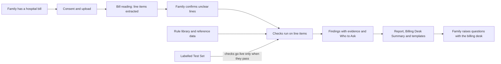

# Scope Document — Hospital Bill Check (Project RS, Phase 1)

This document sets the in/out boundary for this build, the minimum first release, and the order of work. It builds on:

- the approved intent statement (`intent-statement.md`, in `ideation/intent-capture/`);
- the feasibility findings in `ideation/feasibility/` (`feasibility-assessment.md`, `constraint-register.md`, `raid-log.md`).

The prioritised backlog of work packages is in `intent-backlog.md`.

## Sources

- [Q1]–[Q8]: answers in `scope-definition-questions.md` in this folder.
- PRD §n, M-n, S-n, C-n (Could Have), W-n, G-n, D-n: `PRDs/app-baseline.md`, v0.14 (PRD-v2).
- Intent capture: the product boundary (Phase 1 MVP plus its internal modules and P0 tooling) and "no fixed timeline" (`intent-statement.md`).

## 1. Scope in one paragraph

This build delivers the Phase 1 Hospital Bill Check: a free, anonymous, single-session web check of Indian hospital bills (PRD §10.2). It covers every **Must Have** and **Should Have** feature in the PRD [Q1]. The one Should Have that moves out is urgent-situation guidance, moved to Phase 1.5 [Q7]. **Could Have** items are deferred to a later build [Q1].

The first release follows the PRD's launch shape [Q2]:

- all Must Have features;
- the 18 most objective checks live;
- the 8 document checks as guidance;
- the remaining checks going live one by one as each passes the Labelled Test Set.

## 2. In scope

### 2.1 Must Have (all in this build)

| # | Feature (PRD §15.1) |
|---|---|
| M1 | Anonymous entry with layered privacy notice and granular consent (relationship to the patient, minors, third-party patients) |
| M2 | Single-session case with auto-inferred details and progress |
| M3 | Upload of hospital bills, pharmacy bills, implant invoices and stickers, discharge summary, estimate or package letter, receipts (PDF and photos) |
| M4 | Summary-vs-itemised bill detection and an itemised-bill request template |
| M5 | Extraction of header, line items, totals and discharge-summary facts, with confidence and user correction |
| M6 | Normalisation and categorisation of line items, including unbundling tags |
| M7 | Cross-document validation, completeness statements, user confirmation of low-confidence fields |
| M8 | The 18-check launch set live, document checks as guidance, Waves 2–3 following as each passes. Unusual-charge and excessive-consumable flagging (AA-03, AA-04) is built for launch, and its checks appear only once they pass the test set [Q4] |
| M9 | MRP and NPPA ceiling-price / device-cap checks |
| M10 | Bill Breakdown and hospital-side "Who to Ask" |
| M11 | Recommendations: explanation, observation, concern, follow-up action; Top 3 actions |
| M12 | Hospital-side templates: itemised bill request, billing query list, implant/package document request, revised bill / explanation / refund request |
| M13 | Audit Report and one-page Billing Desk Summary; PDF download in the session; regeneration on corrections; limitations and "hospital billing only" statement |
| M14 | In-session "Will ask" checklist; hospital escalation ladder in the report |
| M15 | Quality measurement against the Labelled Test Set; shadow mode until a check passes |
| M16 | Mobile web and desktop web |
| M17 | Session and data storage: no profile, originals deleted, de-identified data stored only with consent, download prompt, session expiry, 3-month deletion |
| M18 | Finding-level feedback and in-session outcome questions |
| M19 | Rule library with versioning, sources, on/off and shadow-mode switches, and a regulatory change process |
| M20 | Ops views, role-based access, audit logs, quality dashboard |
| M21 | Disclaimers, language guardrails, no ads or referral fees |
| M22 | Security, privacy, data residency and incident-response requirements (residency itself is still a founder decision; see section 6) |

The 18 launch checks (PRD §13.6, "P1 · Launch"):

- **Arithmetic:** CAL-01 line amount, CAL-02 section subtotals, CAL-03 grand total, CAL-04 discounts, CAL-06 credits, CAL-07 balance due.
- **Duplicates:** DUP-01 exact duplicates, DUP-06 cross-bill duplicates, DUP-07 interim carry-forward.
- **Stay and room:** LOS-01 room days vs stay, LOS-03 out-of-window charges, RM-02 room rate consistency.
- **Prices:** RX-01 above MRP, RX-02 above ceiling price, RX-03 rate inconsistency, CON-04 consumables above MRP, IMP-02 stent and knee-implant price caps.
- **Packages:** PKG-01 package rate.

### 2.2 Should Have (in this build)

| # | Feature (PRD §15.2) |
|---|---|
| S1 | Share into the platform from messaging apps (for example a bill forwarded on WhatsApp) |
| S2 | Hospital grievance escalation letter; NPPA complaint pointer |
| S3 | Wave 2 and Wave 3 checks after launch |
| S4 | Dispute pack inside the downloaded report |
| S5 | Handling of password-protected PDFs |
| S6 | "What to do next time" learnings |
| S8 | Anonymous count of interest in the Insurance Check from insured users |
| S9 | Identity-free abuse controls for the free tier |
| — | Implant make/model/batch capture; Labelled Test Set coverage reporting and top-ups (DP-14, LT-12, LT-13) |

### 2.3 Internal tools (in this build, leanest form)

The rule library (M19), ops/admin (M20) and Labelled Test Set tooling (M15, LT-01–LT-11) are in scope. They are built in the **leanest form that meets each requirement**, with minimal internal screens that are improved later [Q6]. They need their own strong sign-in, because there is no company sign-in to reuse (`constraint-register.md`, CR-T11).

## 3. Out of scope

| Item | Why | Where it goes |
|---|---|---|
| Could Have: public knowledge content hub (KB-06); implant identity, operation-theatre duration and anaesthesia checks (IMP-04, OT-03, OT-04); content moderation guidance for user-edited templates (OP-05) | Deferred by your choice [Q1] | A later build |
| S7 urgent-situation guidance (TS-03), and a new pay-under-protest guidance requirement (PRD gap G-12) | Your answer: "Move this scenario to phase 1.5" [Q7] | Phase 1.5 |
| Everything in the PRD's Won't Have list, W1–W22: all insurance checks, pre-admission review, representation, success fees, AI clinical opinions, user-visible price benchmarks, hospital rankings, integrations with hospitals or insurers, B2B, government schemes, Hindi and regional languages, insurance selling, OPD / dental / maternity-only / diagnostics-only bills, accounts and login, notifications, cross-session Stay Mode, storing original files, long-term outcome tracking, experts, payments, collecting contact details, a native app | PRD §10.3 | Later phases or never, as the PRD states |
| Phase 1.5 (Expert Review) and every later phase | Outside the confirmed product boundary (`intent-statement.md`) | — |

**A rule that still applies after the Q7 deferral.** The report must never encourage families to withhold payment in a way that blocks discharge or treatment. This is hard constraint C10 in the PRD and CR-R5 in `constraint-register.md`, and the language guardrails (M21) must enforce it. Without dedicated pay-under-protest guidance, the patient-welfare risk (PRD RK15, impact 5) stays partly open until Phase 1.5. It is recorded in `intent-backlog.md`.

## 4. PRD gaps resolved at this stage

The resolutions follow your choices here and the intent-capture rule: where the PRD offers a single suggestion, that suggestion is the decision.

| Gap | Resolution | Source |
|---|---|---|
| G-03: no source for typical quantities | Search for a public source first. Derive ranges from the Labelled Test Set only if none is found | [Q3] |
| G-04: Must Haves depend on Wave 3 checks | AA-03 and AA-04 are built for launch; their checks appear only when they pass | [Q4] |
| G-12: pay-under-protest guidance | Moved to Phase 1.5, together with urgent-situation guidance | [Q7] |
| G-06: "join" implies contact details | Measure interest as an anonymous count of "I want the Insurance Check" clicks | PRD single suggestion |
| G-11: no Phase 1 escalation deadlines | Add hospital-side escalation timelines to the Phase 1 reference data | PRD single suggestion |
| G-13: named owners do not exist | Map each owner role to a named person in Phase 1: you or the founder | PRD single suggestion |
| G-16: no minimum test-set size per check | Set a minimum number of positive and negative examples per check before it goes live; the number is set in Requirements Analysis | PRD single suggestion |
| G-20: interim carry-forward needs both bills | Say so in the capture guidance | PRD single suggestion |
| G-22: IRDAI list mapping appears twice | Limit consumable mapping (DP-13) to the Lists II–IV unbundling reference | PRD single suggestion |

Gaps left for later stages, because their suggestions offer a choice that first matters there:

- G-09: abuse controls vs no profile.
- G-10: session timeout value.
- G-17: whether the beta continues after launch.
- G-18: wording of the two extra "Who to Ask" routes.
- G-19: recommendations with no requirement.
- G-21: missing acceptance criteria.

Gaps that are outside this build or held by the founder:

- G-01, G-05, G-07, G-08, G-15: pricing and later phases.
- G-02: the bill-correction measure, which stays open for the founder (`intent-statement.md`).
- G-14: data residency, a founder decision.

## 5. Order of work

**Value first** [Q5], with the bill-reading trial running first [Q8]:

1. **Start the bill-reading trial** on synthetic bills, which also starts the Labelled Test Set. This meets feasibility condition F1 (`feasibility-assessment.md`).
2. **At the same time, build the user features that do not depend on which bill-reading option wins:**
   - consent and upload screens;
   - the checks, working on already-extracted line items;
   - the report, Billing Desk Summary and templates.
3. **Connect the chosen bill reader** once the trial picks it. Repeat the trial on real bills before the choice is final (feasibility Q12).
4. **Then the remaining user features, then the internal tools,** in the leanest form [Q6].
5. **Launch** when all Must Have features are in and the 18 launch checks pass the Labelled Test Set (PRD M8, M15).

The Labelled Test Set and its tooling come late in this order, but they are on the launch path: no check can go live without them (PRD NFR-05). `intent-backlog.md` marks this dependency.

## 6. Value stream

How value flows from a family's bill to a question put to the billing desk:

Text version: a family with a hospital bill gives consent and uploads it. The bill is read into line items, and the family confirms any unclear lines. The checks run on the line items, using the rule library and reference data, and only checks that have passed the Labelled Test Set are shown. Each finding comes with its evidence and whom to ask. The family downloads the report, the Billing Desk Summary and the templates, and raises their questions with the billing desk.

## 7. Scope against feasibility and timeline

- **No fixed timeline** (`intent-statement.md`), so there is no deadline for this scope to conflict with.
- **The PRD's 3–4-month launch estimate does not apply to this build** (founder decision D21; intent capture).
- **The risk is pace, not deadline.** Must Have plus Should Have is a large scope for one builder (`raid-log.md`, R3). The value-first order means user features take shape early, but launch still waits for the internal tools and the Labelled Test Set.
- **Feasibility conditions F1–F5 still hold** (`feasibility-assessment.md`, section 7). The founder's residency decision (F2) comes before hosting, and both come before anything that stores data.

## Assumptions & Open Questions

- Whether a public source of typical quantities exists is not yet known [Q3].
- The minimum number of examples per check (G-16) is set in Requirements Analysis.
- Data residency (G-14) remains open for the founder and affects M22.
