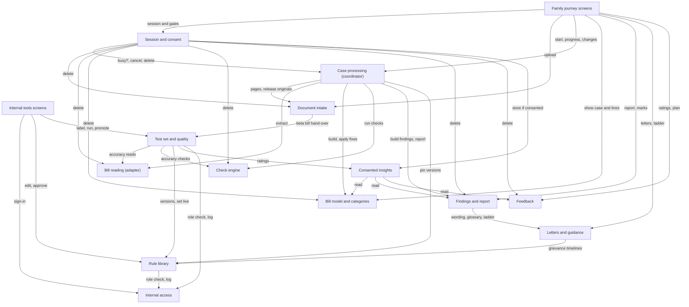
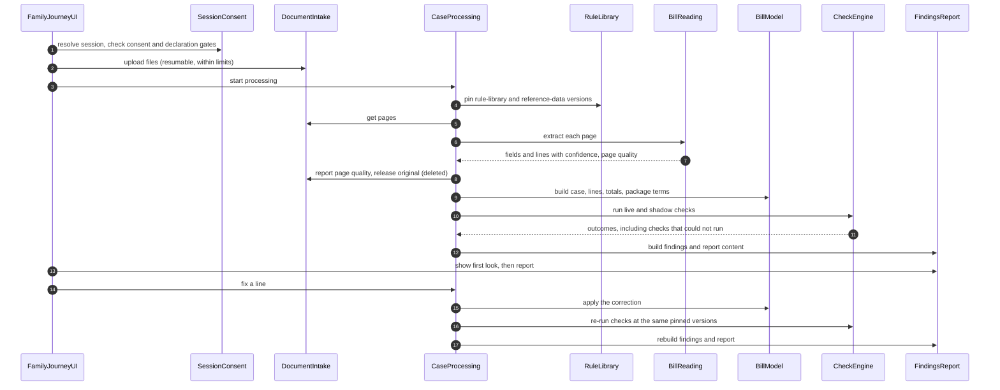
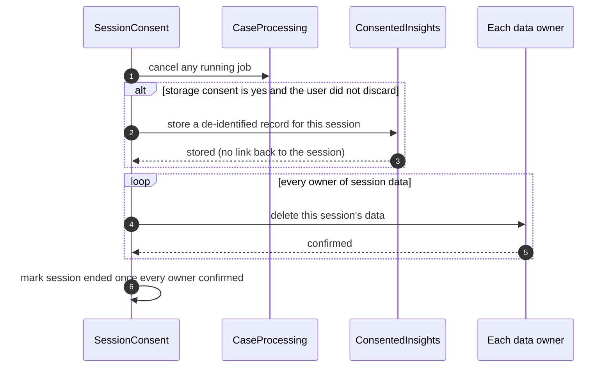

# Domain Design — Component Catalogue (Hospital Bill Check, Phase 1)

This catalogue names the logical building blocks of the Phase 1 Hospital Bill Check: the code we write, not the infrastructure we deploy. It lists 15 components (13 logic blocks and 2 screen blocks), says which block owns each of the 46 entities, and says which block calls which. Databases, file stores, the job runner, the bill-reading service and the identity provider are dependencies of components, not components.

This stage does not decide how the blocks are deployed (Units Generation does), the technology for any store (NFR and Infrastructure Design do), or entity data types and validation (Functional Design does). Entities are captured at ownership and shape level only.

The YAML block below is the source of truth. The diagram and tables after it are derived from it. The reasons behind each boundary are in `decisions.md`.

## Sources

- Answers Q1 to Q9 and the follow-up Q7a in `domain-design-questions.md` in this folder, confirmed through the consolidated summary.
- Requirements: `inception/requirements-analysis/requirements.md` (FR1 to FR16, NFR1 to NFR21, open questions OQ1 to OQ8).
- User stories: `inception/user-stories/stories.md` (US1.1 to US11.8 and decisions D-US1 to D-US23).
- Refined mockups: `inception/refined-mockups/` (screens, interaction spec and the review findings R-15, R-16 and R-17).
- Existing code: `aidlc/spaces/default/codekb/hospital-bill-audit-app/architecture.md` and `component-inventory.md`. The repository is an unmodified Create Next App scaffold (Next.js 16.4.3, React 19, TypeScript strict) with one static page, no data store and no business code, so every component below is new. Cache Components and partial prefetching are on, which is why FamilyJourneyUI renders bill data per request.
- Team practices: `inception/practices-discovery/team-practices.md` (synthetic bills only in tests, real bills out of the AI assistant's reach, the bill reader replaced by recorded outputs in the test suites, the 300 KB script limit, no bill data in shared caches).
- Decisions: `decisions.md` in this folder (ADR-001 to ADR-014).

## Component Catalogue

```yaml
components:
  - name: FamilyJourneyUI
    summary: "The family-facing screens, from start to download, and the server routes behind them."
    behaviour: "Holds no bill logic. Every server route first asks SessionConsent to resolve the session cookie and the consent and declaration gates, and refuses the request when a gate is not passed, so a direct request that skips the screens is refused (US1.4 to US1.7, US7.9). It then passes the validated session ID to the logic blocks. Routes and pages that show bill data or findings are rendered per request, are never prerendered, never use `use cache`, are not prefetched with bill data, and answer with `Cache-Control: no-store` (FR2.10). The Audit Report and Billing Desk Summary PDFs are built on the device from report content; on phones \"Save or share\" opens the phone's share menu and no file goes through our servers (FR10.3, D-US9). Letter edits stay on the device and go only into the downloaded file. Each user route loads at most 300 KB of compressed script on first load; the PDF tool loads only after a tap, within 200 KB. When the line editor is opened from the confirm screen, Back and Save return to the confirm screen and nothing regenerates (R-15). The report screen shows the same \"This is taking too long\" state as the progress screen whenever it waits on a job (R-17). Fixed labels come from one label list; no user-facing string is hard-coded in components (NFR13). Meets WCAG 2.2 AA."
    responsibilities:
      - "start, explainer, privacy notice, consent and declaration screens (at most 2 screens before upload)"
      - "upload screen with \"When are you checking?\", camera guidance and WhatsApp saving guidance"
      - "progress, first look, confirm details, line editor and report screens"
      - "letters, escalation ladder, ratings, plan question, storage question and \"before you go\" reminder"
      - "on-device PDF building and the phone share path"
      - "the 25-minute idle warning with \"Keep going\", and \"Discard everything\""
      - "server-side enforcement of the consent, declaration and session gates on every route"
    depends_on:
      - component: SessionConsent
        interaction: "resolve the session, record consent and declarations, keep the session alive, discard everything"
        style: sync
      - component: DocumentIntake
        interaction: "send files, answer \"When are you checking?\", read the document checklist and page prompts"
        style: sync
      - component: CaseProcessing
        interaction: "start processing, show progress, retry, and send every change (confirmed details, fixed lines, added documents)"
        style: sync
      - component: BillModel
        interaction: "show case details, lines as read and items to confirm"
        style: sync
      - component: FindingsReport
        interaction: "show the first look, findings, Bill Breakdown, Top 3 and report content; record Will ask / Not pursuing"
        style: sync
      - component: LettersGuidance
        interaction: "generate letters, escalation ladder, tips and fixed guidance text for the current findings"
        style: sync
      - component: Feedback
        interaction: "record ratings, the plan answer and the Insurance Check interest"
        style: sync
    dependents: []
    external_dependencies:
      - name: "Phone share menu (Web Share API)"
        kind: other
        purpose: "hand the device-built PDF to the phone's own share menu"
    entities: []
  - name: InternalToolsUI
    summary: "The internal screens for the rule library, the Labelled Test Set, ops views, the quality dashboard and support material."
    behaviour: "Holds no rule or test-set logic. Every internal route requires a signed-in staff account with the right role, checked through InternalAccess before any data is read. The labelling screen never shows AI output or another person's labels (FR16.7). There is no screen that searches for or opens a family's case (FR15.3). Checks can be switched between shadow and off here; a check can be made live only through the promotion screen, which needs a recorded pass."
    responsibilities:
      - "rule library and reference-data editing, change approval and check state switching (shadow, off)"
      - "test-set intake, blind labelling, reconciliation and withdrawal screens"
      - "accuracy runs, coverage report, promotion to live and the quality dashboard"
      - "support material explaining data practices"
    depends_on:
      - component: InternalAccess
        interaction: "sign in, check the staff member's role for each route"
        style: sync
      - component: RuleLibrary
        interaction: "edit rules and reference data, approve changes, switch check states"
        style: sync
      - component: TestSetQuality
        interaction: "add, label, reconcile and withdraw test bills; run accuracy; promote checks; show the dashboard"
        style: sync
    dependents: []
    external_dependencies: []
    entities: []
  - name: SessionConsent
    summary: "The anonymous single session, consent, declarations, the idle timeout and deletion of everything the session holds."
    behaviour: "Creates an unguessable session ID held in an HttpOnly, Secure, same-site cookie that never appears in a URL; an ended or unknown ID is refused (US7.9). No name, phone, email, login or device-linked profile is ever collected (FR2.2). Upload is gated on: the explainer and privacy notice shown, processing consent given, a relationship chosen, authority confirmed, and the guardian declaration for a minor or the consent-or-authority declaration for another adult, including one who has died (FR1.2 to FR1.7). Declining processing consent accepts no file (FR1.11). Storage consent is asked only after the report; no answer by session end counts as no (US7.2). Idle means no real tap or typing: the timer pauses while a report is being prepared (asked of CaseProcessing), warns at 25 minutes and ends the session at 30 (FR2.8, D-US13). On \"Discard everything\", on timeout and on normal end, it runs deletion itself: it cancels processing first, hands the session to ConsentedInsights only when storage consent is yes and the user did not discard, then asks every owner to delete that session's data and records each confirmation; a missing confirmation is retried and raises an alert, and the session stays marked ending until all owners confirm (ADR-002). A closed-beta tester's separate beta consent is recorded here and travels with the session (US9.5)."
    responsibilities:
      - "session identity, lifetime and idle timeout"
      - "privacy notice record, processing consent, storage consent and beta consent"
      - "relationship and authority declarations"
      - "coordinated deletion of all session data with per-owner confirmation"
    depends_on:
      - component: CaseProcessing
        interaction: "ask whether a report is being prepared (pauses the idle timer); cancel processing on discard or timeout; delete jobs"
        style: sync
      - component: DocumentIntake
        interaction: "delete the session's file records, pages and any remaining originals"
        style: sync
      - component: BillReading
        interaction: "delete the session's extraction results"
        style: sync
      - component: BillModel
        interaction: "delete the session's case, lines, totals, clinical summary and corrections"
        style: sync
      - component: CheckEngine
        interaction: "delete the session's check runs and outcomes"
        style: sync
      - component: FindingsReport
        interaction: "delete the session's findings, marks and report content"
        style: sync
      - component: Feedback
        interaction: "delete the session's ratings, plan answer and double-count flag"
        style: sync
      - component: ConsentedInsights
        interaction: "hand over the session for de-identified storage when storage consent is yes"
        style: sync
    dependents:
      - component: FamilyJourneyUI
        interaction: "resolve the session, record consent and declarations, keep the session alive, discard everything"
    external_dependencies:
      - name: "Session data store (technology chosen later)"
        kind: database
        purpose: "sessions, consents and declarations, encrypted at rest"
    entities:
      - name: Session
        identifier: sessionId
        attributes: [state, createdAt, lastActivityAt, idleWarningShownAt, endedAt, endReason, deletionConfirmations]
      - name: ConsentRecord
        identifier: consentId
        attributes: [sessionId, noticeShownAt, explainerShownAt, processingConsent, storageConsent, betaConsent, decidedAt]
      - name: PatientDeclaration
        identifier: declarationId
        attributes: [sessionId, relationship, patientIsMinor, guardianDeclared, adultConsentOrAuthorityDeclared, patientDeceased, authorisedToShare]
  - name: DocumentIntake
    summary: "Receiving files, upload limits, document types, pages, the document checklist and deletion of originals."
    behaviour: "Accepts PDFs, photos and screenshots of the document types in FR4.1, with at most 20 files, 25 MB per file and 60 pages per session; an upload over a limit is refused with the limit named and accepted files stay (FR4.4). Uploads resume after a dropped connection without re-sending finished files; after a reload only unfinished files are chosen again (D-US16). Each file gets a document type the user can correct; a file that is not a hospital document is flagged with remove or keep (FR4.5). Page order, duplicate and missing pages and page legibility are flagged with the page named (FR4.6, FR4.7), using the page quality BillReading reports. A password-protected PDF is unlocked with a password that is used once and never stored or logged (FR4.9). The checklist of present, missing and optional documents follows the answer to \"When are you checking?\"; at discharge it asks for earlier interim bills (FR4.10). Documents can be added until the session ends (FR4.11). The original file is deleted as soon as its content is extracted, also when extraction fails, and in any case at session end; no copy stays in temporary folders, logs or error reports (FR2.3). During the closed beta only, a file from a session with beta consent is handed to TestSetQuality instead of being deleted (FR2.11)."
    responsibilities:
      - "file receipt, resumable upload and upload limits"
      - "document type classification and user correction"
      - "page order, duplicates, missing pages and legibility prompts"
      - "the per-case document checklist and the \"When are you checking?\" answer"
      - "holding originals only until extraction, then deleting them"
    depends_on:
      - component: TestSetQuality
        interaction: "hand over a closed-beta original for redaction and the test set, instead of deleting it (beta only)"
        style: sync
    dependents:
      - component: FamilyJourneyUI
        interaction: "send files, answer \"When are you checking?\", read the document checklist and page prompts"
      - component: SessionConsent
        interaction: "delete the session's file records, pages and any remaining originals"
      - component: CaseProcessing
        interaction: "read pages to process; report page quality; release originals after extraction"
    external_dependencies:
      - name: "Temporary file store (technology chosen later)"
        kind: object-store
        purpose: "hold originals only until their content is extracted, encrypted at rest"
    entities:
      - name: UploadedFile
        identifier: fileId
        attributes: [sessionId, documentType, typeCorrectedByUser, notAHospitalDocument, format, sizeBytes, pageCount, uploadState, passwordProtected, originalDeletedAt]
        references:
          - entity: Session
            owned_by: SessionConsent
            relationship: "each record belongs to one session and is deleted with it"
      - name: Page
        identifier: pageId
        attributes: [fileId, pageNumber, detectedOrder, legibility, duplicateOfPageId, reuploadRequested]
      - name: DocumentChecklist
        identifier: checklistId
        attributes: [sessionId, billStage, presentDocuments, missingDocuments, optionalDocuments]
        references:
          - entity: Session
            owned_by: SessionConsent
            relationship: "each record belongs to one session and is deleted with it"
  - name: BillReading
    summary: "Reading header data, line items, totals and discharge-summary data from each page, behind a replaceable adapter."
    behaviour: "The only block that talks to the bill-reading service, through one adapter interface, so the service can be replaced without changing any check (ADR-005). Every extracted field carries a confidence level (FR5.7). Handles Indian bill features such as lakh and crore grouping, tables across pages, stamps and handwriting (FR5.5). Lines partly in Hindi or a regional script are returned as \"could not be read\" and are never passed on as lines (FR5.6). Reports page legibility and page-of-page markers so DocumentIntake can prompt. Records the reader name and version on every result. The service is called only if it has passed the data-processor check and is contracted not to train on user data (NFR19). In the code test suites the adapter is swapped for recorded outputs of synthetic bills."
    responsibilities:
      - "the bill-reader adapter interface and its implementations"
      - "extraction of header, lines, totals and discharge-summary fields with confidence"
      - "the unread-lines list and page quality signals"
    depends_on: []
    dependents:
      - component: SessionConsent
        interaction: "delete the session's extraction results"
      - component: CaseProcessing
        interaction: "extract each page"
      - component: TestSetQuality
        interaction: "read test bills during accuracy runs"
    external_dependencies:
      - name: "Bill-reading service (chosen by the reader trial, OQ8)"
        kind: third-party-api
        purpose: "read text and tables from bill pages"
    entities:
      - name: ExtractionResult
        identifier: extractionId
        attributes: [sessionId, fileId, pageId, readerName, readerVersion, status, headerFields, lineItems, totals, dischargeSummaryFields, unreadLines, fieldConfidences, pageLegibility]
        references:
          - entity: Session
            owned_by: SessionConsent
            relationship: "each record belongs to one session and is deleted with it"
          - entity: UploadedFile
            owned_by: DocumentIntake
            relationship: "each result reads one uploaded file"
  - name: BillModel
    summary: "The confirmed bill: the case, lines with their standard descriptions and categories, totals, discharge summary and package terms."
    behaviour: "Builds the bill model from extraction results and the rule-library version pinned for the run. Maps every line to a standard catalogue entry while keeping the original text, identifies drugs, consumables (IRDAI Lists II to IV only), implants and professional fees, and assigns exactly one of the 21 categories (FR6.1 to FR6.8). The case holds hospital, city, dates, treatment type, payment mode and insurer or TPA, and never the patient's name (FR3.1); fields read from the documents are pre-filled for the user to confirm (FR3.2). Package terms are taken only from the hospital's own words, on a package letter, an estimate or the bill itself (ADR-011). Checks that patient identifiers, dates and hospital match across documents, checks internal arithmetic, and separates a likely misread from a billing error so misreads go to the user to confirm (FR7.1, FR7.2). Low-confidence fields stay unconfirmed until the user confirms them (FR7.4). Every user correction is recorded (FR5.8). Patient identifiers are read only from ExtractionResult for matching and are never copied into the case or lines."
    responsibilities:
      - "the case and its confirmation"
      - "lines, totals, discharge-summary data and package terms"
      - "normalisation and categorisation against the pinned catalogue"
      - "cross-document consistency and arithmetic checks before the audit"
      - "user corrections"
    depends_on: []
    dependents:
      - component: FamilyJourneyUI
        interaction: "show case details, lines as read and items to confirm"
      - component: SessionConsent
        interaction: "delete the session's case, lines, totals, clinical summary and corrections"
      - component: CaseProcessing
        interaction: "build or rebuild the bill model; apply confirmed details and line fixes"
      - component: ConsentedInsights
        interaction: "read the case, lines and clinical summary to build the record"
    external_dependencies:
      - name: "Session data store (technology chosen later)"
        kind: database
        purpose: "the session's bill model, encrypted at rest"
    entities:
      - name: Case
        identifier: caseId
        attributes: [sessionId, hospitalName, hospitalCity, admissionDate, dischargeDate, treatmentType, paymentMode, insurerOrTpa, detailsConfirmed]
        references:
          - entity: Session
            owned_by: SessionConsent
            relationship: "each record belongs to one session and is deleted with it"
      - name: BillLine
        identifier: lineId
        attributes: [caseId, sourceFileId, sourcePage, sourceLineRef, originalDescription, standardDescription, catalogueEntryId, category, inclusionTag, serviceDate, quantity, unit, unitRate, grossAmount, discount, tax, netAmount, billSection, drugIdentity, implantDetails, feeType, doctor, confidence, confirmed]
        references:
          - entity: UploadedFile
            owned_by: DocumentIntake
            relationship: "each line comes from one uploaded file"
          - entity: CatalogueEntry
            owned_by: RuleLibrary
            relationship: "each line maps to at most one standard catalogue entry"
      - name: BillTotals
        identifier: totalsId
        attributes: [caseId, sectionSubtotals, grossTotal, discounts, taxes, advances, insurerApproved, patientPayable, amountPaid]
      - name: ClinicalSummary
        identifier: summaryId
        attributes: [caseId, diagnosis, procedures, procedureDates, icuPeriods, wardPeriods, implantsUsed, conditionAtDischarge, dischargeMedicines]
      - name: PackageTerms
        identifier: packageTermsId
        attributes: [caseId, packageName, packagePrice, packageDays, inclusions, exclusions, sourceDocument]
      - name: LineCorrection
        identifier: correctionId
        attributes: [lineId, field, oldValue, newValue, correctedAt]
      - name: ConsistencyIssue
        identifier: issueId
        attributes: [caseId, kind, details, resolved]
  - name: CaseProcessing
    summary: "The one coordinator that runs a check as a background job in a fixed order and re-runs from the step that changed."
    behaviour: "Runs read, build bill model, check, build findings and build report in that fixed order as a background job with progress, in arrival order with no priority queue (US3.9, D-US1). At the start of each run it pins one rule-library version and its reference-data versions and passes them to every step, so the same confirmed lines and versions give the same findings (NFR6, D-US23). Every change goes through it: confirmed case details and fixed lines re-run from the check step; an added document re-runs from reading that document onward (FR4.11, FR5.8, FR10.5). After each extraction, successful or failed, it tells DocumentIntake to delete the original (FR2.3). A failed step keeps the completed steps for the session, records which checks did not run and offers a retry (FR7.3). When cancelled it stops and writes nothing afterwards (AC3.9.2). Reports queue length and age for alerting (NFR18)."
    responsibilities:
      - "the background job, its queue and its progress"
      - "the fixed step order and re-running from a changed step"
      - "pinning rule-library and reference-data versions per run"
      - "telling DocumentIntake when an original can be deleted"
      - "cancellation, partial failure and retry"
    depends_on:
      - component: DocumentIntake
        interaction: "read pages to process; report page quality; release originals after extraction"
        style: sync
      - component: BillReading
        interaction: "extract each page"
        style: sync
      - component: BillModel
        interaction: "build or rebuild the bill model; apply confirmed details and line fixes"
        style: sync
      - component: CheckEngine
        interaction: "run the live and shadow checks on the confirmed bill model"
        style: sync
      - component: FindingsReport
        interaction: "build findings, Bill Breakdown, Top 3 and report content"
        style: sync
      - component: RuleLibrary
        interaction: "pin the rule-library and reference-data versions for the run"
        style: sync
    dependents:
      - component: FamilyJourneyUI
        interaction: "start processing, show progress, retry, and send every change (confirmed details, fixed lines, added documents)"
      - component: SessionConsent
        interaction: "ask whether a report is being prepared (pauses the idle timer); cancel processing on discard or timeout; delete jobs"
    external_dependencies:
      - name: "Background job runner (chosen with hosting, OQ2)"
        kind: queue
        purpose: "run jobs of up to 15 minutes in arrival order"
    entities:
      - name: ProcessingJob
        identifier: jobId
        attributes: [sessionId, queuedAt, startedAt, currentStep, stepStatuses, attempt, rerunFromStep, pinnedRuleLibraryVersion, pinnedReferenceVersions, cancelled, failureReason]
        references:
          - entity: Session
            owned_by: SessionConsent
            relationship: "each record belongs to one session and is deleted with it"
  - name: CheckEngine
    summary: "Runs each check that applies, as live or shadow, on the confirmed bill model and the pinned rules."
    behaviour: "Each check is code; its state (live, shadow, off) and its numbers are data read from the pinned rule-library version (ADR-006). Off checks do not run; shadow checks run and are recorded but never reach FindingsReport's user-facing output; live checks run when their inputs are present (FR8.1, FR14.4). A check whose input is missing or depends on an unconfirmed low-confidence field records \"could not run\" with the reason (FR7.3, FR7.4). Runs the launch checks, the document checks DOC-01 to DOC-08 as guidance, and the unusual-charge and quantity capabilities in shadow until they pass (FR8.2 to FR8.11). Prices are compared only with printed MRP, NPPA ceiling prices and device caps; CGHS and PM-JAY rates may appear only as context (FR8.11). The package-inclusion check runs only when PackageTerms has inclusions from the hospital's own words; otherwise it records \"could not run\" and names the package letter (ADR-011). Deterministic: no AI call inside a check."
    responsibilities:
      - "the check runner and the code of every check"
      - "applying live, shadow and off states"
      - "recording which checks ran, which could not and why"
    depends_on: []
    dependents:
      - component: SessionConsent
        interaction: "delete the session's check runs and outcomes"
      - component: CaseProcessing
        interaction: "run the live and shadow checks on the confirmed bill model"
      - component: TestSetQuality
        interaction: "run checks on labelled bill data during accuracy runs"
    external_dependencies: []
    entities:
      - name: CheckRun
        identifier: checkRunId
        attributes: [sessionId, runNumber, ruleLibraryVersion, referenceDataVersions, inputDigest, startedAt]
        references:
          - entity: Session
            owned_by: SessionConsent
            relationship: "each record belongs to one session and is deleted with it"
      - name: CheckOutcome
        identifier: outcomeId
        attributes: [checkRunId, checkId, stateAtRun, status, reasonNotRun, missingInput, results]
        references:
          - entity: CheckDefinition
            owned_by: RuleLibrary
            relationship: "each outcome is for one defined check"
          - entity: BillLine
            owned_by: BillModel
            relationship: "each result cites the bill lines it is about"
  - name: FindingsReport
    summary: "Turns live check results into findings and builds the report content, the Bill Breakdown, the Top 3 and the Billing Desk Summary."
    behaviour: "Groups findings of the same kind (FR8.13) and never counts the same rupee twice; the reconciled amount is shown (FR8.14). Gives each finding its class (Likely error, Worth asking, Explained), confidence, amount, evidence by bill line and page, rule ID and reference version, \"Who to ask\" route and four-part explanation (FR8.12, FR9.1, NFR5). Only four routes exist and no Expert route (FR8.20). Marks a finding \"Complex - consider professional advice\" when its category is on the clinically sensitive list or it questions whether something was medically needed, reading the list and any value threshold from the labelling settings in the rule-library version CaseProcessing pinned for the run (ADR-010). Folds every low-confidence finding under \"Other things you may ask about\"; such findings never enter the Top 3 or the Billing Desk Summary and count as worth asking in the Bill Breakdown (FR8.19, D-US20). The first look shows only the number of things worth a look and their topics, with no Likely error label or rupee total (D-US14). The Billing Desk Summary holds the Will ask findings, or the Top 3 when none is marked (D-US22). Report content has the seven parts of FR10.1 and records the rule-library and reference-data versions (FR8.17). All wording passes LettersGuidance's wording guard before it is returned."
    responsibilities:
      - "findings, grouping and reconciled amounts"
      - "class, confidence, route and the Complex label"
      - "Bill Breakdown, Top 3, first look and Billing Desk Summary content"
      - "Audit Report content with its version stamp and dispute-pack option"
      - "the user's Will ask / Not pursuing marks"
    depends_on:
      - component: LettersGuidance
        interaction: "explanations, glossary terms, escalation ladder, tips and the wording guard for report text"
        style: sync
    dependents:
      - component: FamilyJourneyUI
        interaction: "show the first look, findings, Bill Breakdown, Top 3 and report content; record Will ask / Not pursuing"
      - component: SessionConsent
        interaction: "delete the session's findings, marks and report content"
      - component: CaseProcessing
        interaction: "build findings, Bill Breakdown, Top 3 and report content"
      - component: ConsentedInsights
        interaction: "read the findings to build the record"
    external_dependencies:
      - name: "Session data store (technology chosen later)"
        kind: database
        purpose: "the session's findings and report content, encrypted at rest"
    entities:
      - name: Finding
        identifier: findingId
        attributes: [sessionId, checkRunId, checkIds, category, findingClass, confidence, affectedAmount, evidenceLines, regulatoryReference, ruleLibraryVersion, referenceDataVersion, route, complexLabel, folded, explanation, observation, potentialConcern, followUpActions]
        references:
          - entity: Session
            owned_by: SessionConsent
            relationship: "each record belongs to one session and is deleted with it"
          - entity: CheckOutcome
            owned_by: CheckEngine
            relationship: "each finding comes from one or more check outcomes"
          - entity: BillLine
            owned_by: BillModel
            relationship: "each finding cites the lines it is about"
      - name: FindingMark
        identifier: markId
        attributes: [findingId, mark, markedAt]
      - name: ReportContent
        identifier: reportId
        attributes: [sessionId, revision, ruleLibraryVersion, referenceDataVersions, summary, billBreakdown, topThree, findingsByCategory, lineAppendix, checksPerformed, checksNotRun, nextSteps, limitations, billingDeskSummary, disputePackIncluded]
        references:
          - entity: Session
            owned_by: SessionConsent
            relationship: "each record belongs to one session and is deleted with it"
  - name: LettersGuidance
    summary: "The wording the product speaks with: letters, guidance text, the glossary, the escalation ladder and the wording guard."
    behaviour: "Generates the editable letters of FR9.4 and FR9.5 from the findings it is given; generated letters are returned, not stored. Holds the fixed guidance texts (explainer, disclaimers, summary-bill request, WhatsApp saving guidance, \"What to do next time\" tips) and the glossary with plain explanations (FR10.4). Builds the escalation ladder with deadlines from the pinned grievance-timeline reference data (FR9.7). The wording guard rejects \"fraud\", \"scam\", \"cheating\" and \"illegal\", requires hedged wording for non-objective findings and a line and page reference, and allows no text that encourages withholding payment in a way that blocks discharge or treatment (FR13.2, FR13.3). For a family whose patient has died, the heading \"What to do next time\" stays and only the tips are rephrased (R-16). Names only the hospital billing desk, patient relations or the medical superintendent as whom to ask (FR9.2). Never sends anything to a hospital or insurer (FR11.3)."
    responsibilities:
      - "letter templates and letter generation"
      - "fixed guidance text, tips and disclaimers"
      - "the glossary of medical and insurance terms"
      - "the escalation ladder and its deadlines"
      - "the wording guard applied to every output"
    depends_on:
      - component: RuleLibrary
        interaction: "read grievance-timeline reference data at the pinned version for ladder deadlines"
        style: sync
    dependents:
      - component: FamilyJourneyUI
        interaction: "generate letters, escalation ladder, tips and fixed guidance text for the current findings"
      - component: FindingsReport
        interaction: "explanations, glossary terms, escalation ladder, tips and the wording guard for report text"
    external_dependencies: []
    entities:
      - name: LetterTemplate
        identifier: templateId
        attributes: [letterType, body, version, wordingCheckedAt]
      - name: GuidanceText
        identifier: guidanceId
        attributes: [topic, text, variants, version]
      - name: GlossaryTerm
        identifier: termId
        attributes: [term, plainExplanation, version]
      - name: WordingRule
        identifier: wordingRuleId
        attributes: [kind, pattern, replacementAdvice, version]
  - name: Feedback
    summary: "Ratings of findings, the \"what do you plan to do next\" answer and the anonymous Insurance Check count."
    behaviour: "Each finding can be rated helpful, not helpful or wrong, with a fixed reason only (FR12.1, D-US19). The plan question asks only about plans, never whether a paid bill was revised (FR12.2). \"I want the Insurance Check\" is shown only for cashless or reimbursement cases and adds one to a single total with no session ID, case ID or exact time; a per-session flag stops double counting and is deleted with the session (FR12.4, US6.6)."
    responsibilities:
      - "finding ratings with fixed reasons"
      - "the plan answer"
      - "the anonymous Insurance Check total and its per-session double-count flag"
    depends_on: []
    dependents:
      - component: FamilyJourneyUI
        interaction: "record ratings, the plan answer and the Insurance Check interest"
      - component: SessionConsent
        interaction: "delete the session's ratings, plan answer and double-count flag"
      - component: ConsentedInsights
        interaction: "read ratings and the plan answer to build the record"
    external_dependencies:
      - name: "Session data store (technology chosen later)"
        kind: database
        purpose: "the session's ratings and plan answer; the anonymous total"
    entities:
      - name: FindingRating
        identifier: ratingId
        attributes: [sessionId, findingId, rating, fixedReason]
        references:
          - entity: Session
            owned_by: SessionConsent
            relationship: "each record belongs to one session and is deleted with it"
          - entity: Finding
            owned_by: FindingsReport
            relationship: "each rating is about one finding"
      - name: PlanAnswer
        identifier: planAnswerId
        attributes: [sessionId, answer]
        references:
          - entity: Session
            owned_by: SessionConsent
            relationship: "each record belongs to one session and is deleted with it"
      - name: InsuranceInterestTotal
        identifier: counterId
        attributes: [count]
      - name: InterestClickFlag
        identifier: flagId
        attributes: [sessionId, clicked]
        references:
          - entity: Session
            owned_by: SessionConsent
            relationship: "each record belongs to one session and is deleted with it"
  - name: ConsentedInsights
    summary: "The separate store of de-identified records kept with storage consent, their 3-month deletion and grouping for quality work."
    behaviour: "Called by SessionConsent at session close only when storage consent is yes. Assembles one record from BillModel, FindingsReport and Feedback and keeps only: line items with categories, quantities, rates and amounts, dated by day of the stay; hospital; city; findings; ratings with fixed reasons; age band (10 years); gender; admission month; length of stay; procedure; diagnosis; and the plan answer (FR2.5, FR2.6, D-US2, D-US21). Removes the patient's name, UHID or IP number, phone, address and policy number, including inside line descriptions (AC7.2.4). The record gets a new random ID and holds no session ID, case ID or link back to the session. Lives in a store apart from session data. A scheduled deletion run removes every record older than 3 months and raises an alert if a run fails (FR2.9). Groups records by hospital, city, procedure and finding type for internal quality work, from consented records only (FR12.3). Keeping hospital and exact procedure for rare combinations is an accepted privacy risk for counsel to review before launch (ADR-008)."
    responsibilities:
      - "assembling and de-identifying the consented record"
      - "the separate consented store"
      - "3-month automatic deletion and its alert"
      - "grouping consented records for quality work"
    depends_on:
      - component: BillModel
        interaction: "read the case, lines and clinical summary to build the record"
        style: sync
      - component: FindingsReport
        interaction: "read the findings to build the record"
        style: sync
      - component: Feedback
        interaction: "read ratings and the plan answer to build the record"
        style: sync
    dependents:
      - component: SessionConsent
        interaction: "hand over the session for de-identified storage when storage consent is yes"
      - component: TestSetQuality
        interaction: "read grouped ratings for the dashboard"
    external_dependencies:
      - name: "Consented data store (technology chosen later)"
        kind: database
        purpose: "de-identified records, apart from session data, encrypted at rest"
      - name: "Scheduler (chosen with hosting, OQ2)"
        kind: other
        purpose: "run the daily deletion of records older than 3 months"
    entities:
      - name: StoredCaseRecord
        identifier: recordId
        attributes: [storedAt, deleteBy, hospital, city, ageBand, gender, admissionMonth, lengthOfStay, procedure, diagnosis, planAnswer, lines, findings, ratings]
      - name: DeletionRun
        identifier: deletionRunId
        attributes: [ranAt, recordsDeleted, status]
  - name: RuleLibrary
    summary: "Check settings, reference data, the standard catalogue and labelling settings, versioned, with approved changes."
    behaviour: "Holds data only, never check logic: each check's state (live, shadow, off) and thresholds; reference lists (NPPA ceiling prices, device caps, IRDAI Lists II to IV, hospital-side grievance timelines); the standard catalogue of drugs, consumables, procedures and investigations; and the labelling settings, including the clinically sensitive category list and the Complex value threshold, unset at launch (FR14.1, FR14.5, FR8.16, ADR-010). Every rule and reference item carries source, effective dates, version, owner and review date, and cannot be saved without them (FR14.2); owners are the builder or the founder (FR14.6). Every change records who, what, why and source and takes effect only once approved; the person who made it may approve it, and that is logged (NFR15, D-US18). Each approved set of changes publishes a new library version; runs read a pinned version. A check can be set live only with a PromotionRecord reference supplied by TestSetQuality; shadow and off can be set from the internal tools. Staff identity and role are checked through InternalAccess for every change and approval."
    responsibilities:
      - "check states and thresholds"
      - "reference data with sources and versions"
      - "the standard catalogue"
      - "labelling settings, including the clinically sensitive list"
      - "change approval and library versions"
    depends_on:
      - component: InternalAccess
        interaction: "check the staff member's role for changes and approvals, and log the action"
        style: sync
    dependents:
      - component: InternalToolsUI
        interaction: "edit rules and reference data, approve changes, switch check states"
      - component: CaseProcessing
        interaction: "pin the rule-library and reference-data versions for the run"
      - component: LettersGuidance
        interaction: "read grievance-timeline reference data at the pinned version for ladder deadlines"
      - component: TestSetQuality
        interaction: "read rule versions for a run; set a check live with its promotion record"
    external_dependencies:
      - name: "Rule library store (technology chosen later)"
        kind: database
        purpose: "versioned rules, reference data and catalogue"
    entities:
      - name: CheckDefinition
        identifier: checkId
        attributes: [name, family, state, thresholds, promotionRecordId, source, effectiveFrom, effectiveTo, version, owner, reviewDate]
        references:
          - entity: PromotionRecord
            owned_by: TestSetQuality
            relationship: "a live check points to the promotion record that allowed it"
      - name: ReferenceItem
        identifier: referenceItemId
        attributes: [list, key, value, unit, source, effectiveFrom, effectiveTo, version, owner, reviewDate]
      - name: CatalogueEntry
        identifier: catalogueEntryId
        attributes: [kind, standardName, synonyms, genericName, strength, dosageForm, irdaiListRef, version]
      - name: LabellingSettings
        identifier: settingsId
        attributes: [complexCategories, medicalNecessityIsComplex, complexValueThreshold, version]
      - name: RuleChange
        identifier: changeId
        attributes: [targetType, targetId, before, after, why, source, proposedBy, approvedBy, selfApproved, approvedAt, status]
        references:
          - entity: StaffAccount
            owned_by: InternalAccess
            relationship: "each change is proposed and approved by staff accounts"
      - name: LibraryVersion
        identifier: libraryVersionId
        attributes: [publishedAt, changeIds]
  - name: TestSetQuality
    summary: "The Labelled Test Set, blind labelling, accuracy runs, promotion of checks to live and the quality dashboard."
    behaviour: "Holds test bills from the personal network with written consent, synthetic bills with answer keys and closed-beta bills with beta consent, in a store apart from product data and kept for the life of the set (FR16.2, FR16.8). Real bills are blacked out on receipt (FR16.4) and never enter git or any folder the AI coding assistant can open (FR16.13). Two people label each real bill without seeing each other's labels or any AI output, then reconcile with a recorded reason (FR16.5, FR16.7). An accuracy run reads test bills through BillReading on approved services only and runs CheckEngine on labelled bill data; its outputs keep only bill IDs and scores, never bill content (ADR-009). A check is promoted only when measured on at least 10 bills with its error and 30 without and meeting its precision target, and the promotion record is then passed to RuleLibrary (FR16.12, FR15.1). On withdrawal, the bill's redacted original, labels and reconciliation are deleted, caches are cleared, backups expire within 30 days and the bill is never restored from a backup (FR16.9, ADR-009). The dashboard shows reading accuracy, precision by check, missed-issue rate and user ratings, ratings coming from consented records only (FR15.4). Every access to test-set data is logged through InternalAccess."
    responsibilities:
      - "test bills, consents, redaction and answer keys"
      - "blind labelling and reconciliation"
      - "accuracy runs and coverage reports"
      - "promotion records"
      - "withdrawal"
      - "the quality dashboard"
    depends_on:
      - component: BillReading
        interaction: "read test bills during accuracy runs"
        style: sync
      - component: CheckEngine
        interaction: "run checks on labelled bill data during accuracy runs"
        style: sync
      - component: RuleLibrary
        interaction: "read rule versions for a run; set a check live with its promotion record"
        style: sync
      - component: ConsentedInsights
        interaction: "read grouped ratings for the dashboard"
        style: sync
      - component: InternalAccess
        interaction: "check roles and log every access to test-set data"
        style: sync
    dependents:
      - component: InternalToolsUI
        interaction: "add, label, reconcile and withdraw test bills; run accuracy; promote checks; show the dashboard"
      - component: DocumentIntake
        interaction: "hand over a closed-beta original for redaction and the test set, instead of deleting it (beta only)"
    external_dependencies:
      - name: "Test-set store (technology chosen later)"
        kind: database
        purpose: "redacted originals, labels and runs, apart from product data, encrypted at rest"
      - name: "Bill-reading service on approved terms"
        kind: third-party-api
        purpose: "used only through BillReading during accuracy runs"
    entities:
      - name: TestBill
        identifier: testBillId
        attributes: [source, contributorConsentId, redactedOriginalRef, redactionCheckedAt, hospitalType, indianState, procedureType, format, captureQuality, withdrawnAt]
      - name: ContributorConsent
        identifier: contributorConsentId
        attributes: [consentKind, consentDocumentRef, givenAt, withdrawnAt]
      - name: Label
        identifier: labelId
        attributes: [testBillId, labeller, lineLabels, findingLabels, labelledAt]
        references:
          - entity: StaffAccount
            owned_by: InternalAccess
            relationship: "each label is made by one staff member"
      - name: Reconciliation
        identifier: reconciliationId
        attributes: [testBillId, differences, resolution, reason, publicSourceRef]
      - name: AnswerKey
        identifier: answerKeyId
        attributes: [testBillId, plantedErrors, expectedFindings]
      - name: AccuracyRun
        identifier: accuracyRunId
        attributes: [ranAt, readerVersion, promptOrModelVersion, ruleLibraryVersion, serviceApproved, perBillScores, lineAccuracyPdf, lineAccuracyPhoto, precisionByCheck, missedIssueRate, coverage]
      - name: PromotionRecord
        identifier: promotionId
        attributes: [checkId, accuracyRunId, billsWithError, billsWithout, measuredPrecision, target, promotedBy, promotedAt]
        references:
          - entity: CheckDefinition
            owned_by: RuleLibrary
            relationship: "each promotion is for one check"
          - entity: StaffAccount
            owned_by: InternalAccess
            relationship: "each promotion is made by one staff member"
      - name: WithdrawalRecord
        identifier: withdrawalId
        attributes: [testBillId, requestedAt, deletedAt, cachesClearedAt, backupsExpireBy]
  - name: InternalAccess
    summary: "Sign-in, roles and the access log for the internal tools."
    behaviour: "Staff accounts exist only for the builder and the founder. Roles are ops, domain admin and support, each with least-privilege access (FR15.2). The sign-in method is set in NFR Requirements (D-US4). Every access to personal data, meaning test-set data, creates an access-log entry; the owning block calls InternalAccess to record it. Family sessions never use this block: families have no accounts (FR2.2)."
    responsibilities:
      - "staff accounts and roles"
      - "sign-in and role checks"
      - "the access log"
    depends_on: []
    dependents:
      - component: InternalToolsUI
        interaction: "sign in, check the staff member's role for each route"
      - component: RuleLibrary
        interaction: "check the staff member's role for changes and approvals, and log the action"
      - component: TestSetQuality
        interaction: "check roles and log every access to test-set data"
    external_dependencies:
      - name: "Identity provider (chosen in NFR Requirements)"
        kind: third-party-api
        purpose: "strong sign-in for staff"
    entities:
      - name: StaffAccount
        identifier: staffId
        attributes: [displayName, roles, signInMethodRef, active]
      - name: AccessLogEntry
        identifier: accessLogId
        attributes: [staffId, at, action, targetType, targetId]
```

## Component Diagram




Text fallback: Family journey screens calls Session and consent, Document intake, Case processing (coordinator), Bill model and categories, Findings and report, Letters and guidance, Feedback; Internal tools screens calls Internal access, Rule library, Test set and quality; Session and consent calls Case processing (coordinator), Document intake, Bill reading (adapter), Bill model and categories, Check engine, Findings and report, Feedback, Consented insights; Document intake calls Test set and quality; Case processing (coordinator) calls Document intake, Bill reading (adapter), Bill model and categories, Check engine, Findings and report, Rule library; Findings and report calls Letters and guidance; Letters and guidance calls Rule library; Consented insights calls Bill model and categories, Findings and report, Feedback; Rule library calls Internal access; Test set and quality calls Bill reading (adapter), Check engine, Rule library, Consented insights, Internal access.

The graph has no cycles. The blocks at the bottom (CheckEngine, BillModel, BillReading, Feedback and InternalAccess) call no other block, so each can be tested on its own with plain inputs.

## Component Summary

| Component | Purpose | Depends On | Dependents | Entities Owned |
|---|---|---|---|---|
| FamilyJourneyUI | The family-facing screens, from start to download, and the server routes behind them. | SessionConsent, DocumentIntake, CaseProcessing, BillModel, FindingsReport, LettersGuidance, Feedback | none | none (holds no stored data) |
| InternalToolsUI | The internal screens for the rule library, the Labelled Test Set, ops views, the quality dashboard and support material. | InternalAccess, RuleLibrary, TestSetQuality | none | none (holds no stored data) |
| SessionConsent | The anonymous single session, consent, declarations, the idle timeout and deletion of everything the session holds. | CaseProcessing, DocumentIntake, BillReading, BillModel, CheckEngine, FindingsReport, Feedback, ConsentedInsights | FamilyJourneyUI | Session, ConsentRecord, PatientDeclaration |
| DocumentIntake | Receiving files, upload limits, document types, pages, the document checklist and deletion of originals. | TestSetQuality | FamilyJourneyUI, SessionConsent, CaseProcessing | UploadedFile, Page, DocumentChecklist |
| BillReading | Reading header data, line items, totals and discharge-summary data from each page, behind a replaceable adapter. | none | SessionConsent, CaseProcessing, TestSetQuality | ExtractionResult |
| BillModel | The confirmed bill: the case, lines with their standard descriptions and categories, totals, discharge summary and package terms. | none | FamilyJourneyUI, SessionConsent, CaseProcessing, ConsentedInsights | Case, BillLine, BillTotals, ClinicalSummary, PackageTerms, LineCorrection, ConsistencyIssue |
| CaseProcessing | The one coordinator that runs a check as a background job in a fixed order and re-runs from the step that changed. | DocumentIntake, BillReading, BillModel, CheckEngine, FindingsReport, RuleLibrary | FamilyJourneyUI, SessionConsent | ProcessingJob |
| CheckEngine | Runs each check that applies, as live or shadow, on the confirmed bill model and the pinned rules. | none | SessionConsent, CaseProcessing, TestSetQuality | CheckRun, CheckOutcome |
| FindingsReport | Turns live check results into findings and builds the report content, the Bill Breakdown, the Top 3 and the Billing Desk Summary. | LettersGuidance | FamilyJourneyUI, SessionConsent, CaseProcessing, ConsentedInsights | Finding, FindingMark, ReportContent |
| LettersGuidance | The wording the product speaks with: letters, guidance text, the glossary, the escalation ladder and the wording guard. | RuleLibrary | FamilyJourneyUI, FindingsReport | LetterTemplate, GuidanceText, GlossaryTerm, WordingRule |
| Feedback | Ratings of findings, the "what do you plan to do next" answer and the anonymous Insurance Check count. | none | FamilyJourneyUI, SessionConsent, ConsentedInsights | FindingRating, PlanAnswer, InsuranceInterestTotal, InterestClickFlag |
| ConsentedInsights | The separate store of de-identified records kept with storage consent, their 3-month deletion and grouping for quality work. | BillModel, FindingsReport, Feedback | SessionConsent, TestSetQuality | StoredCaseRecord, DeletionRun |
| RuleLibrary | Check settings, reference data, the standard catalogue and labelling settings, versioned, with approved changes. | InternalAccess | InternalToolsUI, CaseProcessing, LettersGuidance, TestSetQuality | CheckDefinition, ReferenceItem, CatalogueEntry, LabellingSettings, RuleChange, LibraryVersion |
| TestSetQuality | The Labelled Test Set, blind labelling, accuracy runs, promotion of checks to live and the quality dashboard. | BillReading, CheckEngine, RuleLibrary, ConsentedInsights, InternalAccess | InternalToolsUI, DocumentIntake | TestBill, ContributorConsent, Label, Reconciliation, AnswerKey, AccuracyRun, PromotionRecord, WithdrawalRecord |
| InternalAccess | Sign-in, roles and the access log for the internal tools. | none | InternalToolsUI, RuleLibrary, TestSetQuality | StaffAccount, AccessLogEntry |

## Entity Ownership

Every entity has exactly one owner. A reference to an entity in another block is by ID only and does not create a call between the blocks. Most session data is keyed by `sessionId` and is deleted through its owner when the session ends (ADR-002). Two entities deliberately carry no session link: `StoredCaseRecord` (ConsentedInsights) and `InsuranceInterestTotal` (Feedback).

| Entity | Owning Component | Identifier | Attributes | References |
|---|---|---|---|---|
| Session | SessionConsent | sessionId | state, createdAt, lastActivityAt, idleWarningShownAt, endedAt, endReason, deletionConfirmations | none |
| ConsentRecord | SessionConsent | consentId | sessionId, noticeShownAt, explainerShownAt, processingConsent, storageConsent, betaConsent, decidedAt | none |
| PatientDeclaration | SessionConsent | declarationId | sessionId, relationship, patientIsMinor, guardianDeclared, adultConsentOrAuthorityDeclared, patientDeceased, authorisedToShare | none |
| UploadedFile | DocumentIntake | fileId | sessionId, documentType, typeCorrectedByUser, notAHospitalDocument, format, sizeBytes, pageCount, uploadState, passwordProtected, originalDeletedAt | Session (SessionConsent): each record belongs to one session and is deleted with it |
| Page | DocumentIntake | pageId | fileId, pageNumber, detectedOrder, legibility, duplicateOfPageId, reuploadRequested | none |
| DocumentChecklist | DocumentIntake | checklistId | sessionId, billStage, presentDocuments, missingDocuments, optionalDocuments | Session (SessionConsent): each record belongs to one session and is deleted with it |
| ExtractionResult | BillReading | extractionId | sessionId, fileId, pageId, readerName, readerVersion, status, headerFields, lineItems, totals, dischargeSummaryFields, unreadLines, fieldConfidences, pageLegibility | Session (SessionConsent): each record belongs to one session and is deleted with it; UploadedFile (DocumentIntake): each result reads one uploaded file |
| Case | BillModel | caseId | sessionId, hospitalName, hospitalCity, admissionDate, dischargeDate, treatmentType, paymentMode, insurerOrTpa, detailsConfirmed | Session (SessionConsent): each record belongs to one session and is deleted with it |
| BillLine | BillModel | lineId | caseId, sourceFileId, sourcePage, sourceLineRef, originalDescription, standardDescription, catalogueEntryId, category, inclusionTag, serviceDate, quantity, unit, unitRate, grossAmount, discount, tax, netAmount, billSection, drugIdentity, implantDetails, feeType, doctor, confidence, confirmed | UploadedFile (DocumentIntake): each line comes from one uploaded file; CatalogueEntry (RuleLibrary): each line maps to at most one standard catalogue entry |
| BillTotals | BillModel | totalsId | caseId, sectionSubtotals, grossTotal, discounts, taxes, advances, insurerApproved, patientPayable, amountPaid | none |
| ClinicalSummary | BillModel | summaryId | caseId, diagnosis, procedures, procedureDates, icuPeriods, wardPeriods, implantsUsed, conditionAtDischarge, dischargeMedicines | none |
| PackageTerms | BillModel | packageTermsId | caseId, packageName, packagePrice, packageDays, inclusions, exclusions, sourceDocument | none |
| LineCorrection | BillModel | correctionId | lineId, field, oldValue, newValue, correctedAt | none |
| ConsistencyIssue | BillModel | issueId | caseId, kind, details, resolved | none |
| ProcessingJob | CaseProcessing | jobId | sessionId, queuedAt, startedAt, currentStep, stepStatuses, attempt, rerunFromStep, pinnedRuleLibraryVersion, pinnedReferenceVersions, cancelled, failureReason | Session (SessionConsent): each record belongs to one session and is deleted with it |
| CheckRun | CheckEngine | checkRunId | sessionId, runNumber, ruleLibraryVersion, referenceDataVersions, inputDigest, startedAt | Session (SessionConsent): each record belongs to one session and is deleted with it |
| CheckOutcome | CheckEngine | outcomeId | checkRunId, checkId, stateAtRun, status, reasonNotRun, missingInput, results | CheckDefinition (RuleLibrary): each outcome is for one defined check; BillLine (BillModel): each result cites the bill lines it is about |
| Finding | FindingsReport | findingId | sessionId, checkRunId, checkIds, category, findingClass, confidence, affectedAmount, evidenceLines, regulatoryReference, ruleLibraryVersion, referenceDataVersion, route, complexLabel, folded, explanation, observation, potentialConcern, followUpActions | Session (SessionConsent): each record belongs to one session and is deleted with it; CheckOutcome (CheckEngine): each finding comes from one or more check outcomes; BillLine (BillModel): each finding cites the lines it is about |
| FindingMark | FindingsReport | markId | findingId, mark, markedAt | none |
| ReportContent | FindingsReport | reportId | sessionId, revision, ruleLibraryVersion, referenceDataVersions, summary, billBreakdown, topThree, findingsByCategory, lineAppendix, checksPerformed, checksNotRun, nextSteps, limitations, billingDeskSummary, disputePackIncluded | Session (SessionConsent): each record belongs to one session and is deleted with it |
| LetterTemplate | LettersGuidance | templateId | letterType, body, version, wordingCheckedAt | none |
| GuidanceText | LettersGuidance | guidanceId | topic, text, variants, version | none |
| GlossaryTerm | LettersGuidance | termId | term, plainExplanation, version | none |
| WordingRule | LettersGuidance | wordingRuleId | kind, pattern, replacementAdvice, version | none |
| FindingRating | Feedback | ratingId | sessionId, findingId, rating, fixedReason | Session (SessionConsent): each record belongs to one session and is deleted with it; Finding (FindingsReport): each rating is about one finding |
| PlanAnswer | Feedback | planAnswerId | sessionId, answer | Session (SessionConsent): each record belongs to one session and is deleted with it |
| InsuranceInterestTotal | Feedback | counterId | count | none |
| InterestClickFlag | Feedback | flagId | sessionId, clicked | Session (SessionConsent): each record belongs to one session and is deleted with it |
| StoredCaseRecord | ConsentedInsights | recordId | storedAt, deleteBy, hospital, city, ageBand, gender, admissionMonth, lengthOfStay, procedure, diagnosis, planAnswer, lines, findings, ratings | none |
| DeletionRun | ConsentedInsights | deletionRunId | ranAt, recordsDeleted, status | none |
| CheckDefinition | RuleLibrary | checkId | name, family, state, thresholds, promotionRecordId, source, effectiveFrom, effectiveTo, version, owner, reviewDate | PromotionRecord (TestSetQuality): a live check points to the promotion record that allowed it |
| ReferenceItem | RuleLibrary | referenceItemId | list, key, value, unit, source, effectiveFrom, effectiveTo, version, owner, reviewDate | none |
| CatalogueEntry | RuleLibrary | catalogueEntryId | kind, standardName, synonyms, genericName, strength, dosageForm, irdaiListRef, version | none |
| LabellingSettings | RuleLibrary | settingsId | complexCategories, medicalNecessityIsComplex, complexValueThreshold, version | none |
| RuleChange | RuleLibrary | changeId | targetType, targetId, before, after, why, source, proposedBy, approvedBy, selfApproved, approvedAt, status | StaffAccount (InternalAccess): each change is proposed and approved by staff accounts |
| LibraryVersion | RuleLibrary | libraryVersionId | publishedAt, changeIds | none |
| TestBill | TestSetQuality | testBillId | source, contributorConsentId, redactedOriginalRef, redactionCheckedAt, hospitalType, indianState, procedureType, format, captureQuality, withdrawnAt | none |
| ContributorConsent | TestSetQuality | contributorConsentId | consentKind, consentDocumentRef, givenAt, withdrawnAt | none |
| Label | TestSetQuality | labelId | testBillId, labeller, lineLabels, findingLabels, labelledAt | StaffAccount (InternalAccess): each label is made by one staff member |
| Reconciliation | TestSetQuality | reconciliationId | testBillId, differences, resolution, reason, publicSourceRef | none |
| AnswerKey | TestSetQuality | answerKeyId | testBillId, plantedErrors, expectedFindings | none |
| AccuracyRun | TestSetQuality | accuracyRunId | ranAt, readerVersion, promptOrModelVersion, ruleLibraryVersion, serviceApproved, perBillScores, lineAccuracyPdf, lineAccuracyPhoto, precisionByCheck, missedIssueRate, coverage | none |
| PromotionRecord | TestSetQuality | promotionId | checkId, accuracyRunId, billsWithError, billsWithout, measuredPrecision, target, promotedBy, promotedAt | CheckDefinition (RuleLibrary): each promotion is for one check; StaffAccount (InternalAccess): each promotion is made by one staff member |
| WithdrawalRecord | TestSetQuality | withdrawalId | testBillId, requestedAt, deletedAt, cachesClearedAt, backupsExpireBy | none |
| StaffAccount | InternalAccess | staffId | displayName, roles, signInMethodRef, active | none |
| AccessLogEntry | InternalAccess | accessLogId | staffId, at, action, targetType, targetId | none |

## External Dependencies

All technology choices are open; the names say what each dependency is for, not which product it is. Every store holding personal or health data is encrypted at rest and reached over TLS (NFR7). None is chosen before the founder decides data residency and hosting (OQ1, OQ2).

| Component | Dependency | Kind | Purpose |
|---|---|---|---|
| FamilyJourneyUI | Phone share menu (Web Share API) | other | hand the device-built PDF to the phone's own share menu |
| SessionConsent | Session data store (technology chosen later) | database | sessions, consents and declarations, encrypted at rest |
| DocumentIntake | Temporary file store (technology chosen later) | object-store | hold originals only until their content is extracted, encrypted at rest |
| BillReading | Bill-reading service (chosen by the reader trial, OQ8) | third-party-api | read text and tables from bill pages |
| BillModel | Session data store (technology chosen later) | database | the session's bill model, encrypted at rest |
| CaseProcessing | Background job runner (chosen with hosting, OQ2) | queue | run jobs of up to 15 minutes in arrival order |
| FindingsReport | Session data store (technology chosen later) | database | the session's findings and report content, encrypted at rest |
| Feedback | Session data store (technology chosen later) | database | the session's ratings and plan answer; the anonymous total |
| ConsentedInsights | Consented data store (technology chosen later) | database | de-identified records, apart from session data, encrypted at rest |
| ConsentedInsights | Scheduler (chosen with hosting, OQ2) | other | run the daily deletion of records older than 3 months |
| RuleLibrary | Rule library store (technology chosen later) | database | versioned rules, reference data and catalogue |
| TestSetQuality | Test-set store (technology chosen later) | database | redacted originals, labels and runs, apart from product data, encrypted at rest |
| TestSetQuality | Bill-reading service on approved terms | third-party-api | used only through BillReading during accuracy runs |
| InternalAccess | Identity provider (chosen in NFR Requirements) | third-party-api | strong sign-in for staff |

## Key Interactions

### A check, from upload to report, and a line fix




Text fallback: the screens check the session gates, upload the files and start processing. The coordinator pins rule versions, reads each page through the bill reader, tells intake to delete each original after reading, builds the bill model, runs the checks and builds the findings and report. A line fix goes through the coordinator, which applies it and re-runs from the check step at the same pinned versions. An added document re-runs from reading that document.

### Session end: discard, timeout or normal end




Text fallback: the session block cancels processing, hands the session to consented insights only when storage consent is yes and the user did not discard, then asks every data owner to delete the session's data and marks the session ended once each has confirmed. A missing confirmation is retried and raises an alert. The owners asked are DocumentIntake, BillReading, BillModel, CaseProcessing, CheckEngine, FindingsReport and Feedback.

## Rationale

| Component | Why it is a separate building block |
|---|---|
| FamilyJourneyUI | Distinct concern and change rate: screens, wording and layout change often and must stay free of bill logic so the logic can be tested without a browser (ADR-004). It also owns the per-request rendering rule for bill data and the on-device PDF (ADR-007). |
| InternalToolsUI | Different users (the builder and founder), a different sign-in and a different risk: it reaches redacted real bills, which family screens never do (ADR-004, ADR-012). |
| SessionConsent | Distinct lifecycle: the session outlives every step of a check, and deletion of everything must be run and confirmed from one place (ADR-002). Consent and declarations gate upload, so they sit with the session. |
| DocumentIntake | Distinct data: it is the only block that ever holds an original file, so the "delete once read" guarantee has one owner (FR2.3). Upload limits, resume and page prompts change with the upload experience, not with the checks. |
| BillReading | Distinct dependency: it isolates the third-party reader behind one adapter so the reader can be replaced without touching any check (ADR-005), and it is the only block whose output is not reproducible. |
| BillModel | Distinct data: the confirmed bill is the shared input to every check and to the consented record. Categorisation and consistency checks change with the catalogue, not with the checks or the screens. |
| CaseProcessing | Distinct concern: the order of steps, re-running after a change, pinning versions, cancellation and retry belong to no single step. Q4's list of about 12 did not name it; the coordinator chosen in Q8 needs a home, so it is the 13th logic block (ADR-001, ADR-003). |
| CheckEngine | Distinct change rate and risk: checks are code that goes through a release, are measured on the test set and must be deterministic (ADR-006). Keeping it free of calls makes every check testable on structured fixtures. |
| FindingsReport | Distinct rules: grouping, no rupee counted twice, classes, routes, folding and the Complex label are presentation rules applied on top of check results and change separately from the checks. |
| LettersGuidance | Distinct content: letters, guidance text, glossary and the wording guard are text that the founder reviews, with their own versions, and the wording guard must apply to every output (FR13.2). |
| Feedback | Distinct data with a different retention path: ratings and the plan answer go into the consented record, while the Insurance Check total must never link to a session. |
| ConsentedInsights | Distinct lifecycle and store: data kept for 3 months after the session, unlinked from it, in a separate store (ADR-008). |
| RuleLibrary | Distinct change process: data changes take effect without a release but only after approval (NFR15). Logic stays in CheckEngine, so the library holds data only (ADR-006). |
| TestSetQuality | Distinct data and retention: redacted real bills kept for the life of the set, apart from product data, with blind labelling and withdrawal (ADR-009). It is also the only place a check can be promoted from (FR15.1). |
| InternalAccess | Distinct security concern: staff identity, roles and the access log are shared by every internal block and must not be reimplemented in each (ADR-012). |

### Alternatives Rejected

- **About 6 coarser blocks** (family journey; bill processing; checking; reporting; insights and feedback; internal tools), Q4 option B. Fewer boundaries, but it mixes data with very different retention in one block: originals with the bill model, consented records with in-session ratings. The deletion guarantees would then be internal rules of a large block instead of block boundaries.
- **One block per story group** (11 blocks), Q4 option C. It follows the journey, not data ownership: the bill model would be split across "Review and confirm" and "Findings", and "Privacy and access throughout the session" is a cross-cutting concern, not a block.
- **One session record for everything**, Q5 option B. Deletion would be a single delete, but every block would read and write one shared record, which is a shared mutable store across boundaries, and the consented record would be harder to keep unlinked.
- **Blocks reacting to change events**, Q8 option B, and **patching findings in place**, Q8 option C. Both weaken reproducibility (NFR6): event order would decide the result, and patched findings could differ from a full re-run on the same inputs.
- **Screens owned by each logic block**, Q9 option B, and **one screens block for family and internal tools together**, Q9 option C. The first spreads per-request rendering and gate checks across many blocks. The second puts redacted real-bill screens next to family screens under one access model.

Each of these is also recorded with its consequences in `decisions.md`.

## Settled design points carried into the catalogue

- **Mockup fixes (Q3, findings R-15 to R-17):** the line editor opened from the confirm screen returns there on Back and Save and nothing regenerates (FamilyJourneyUI). For a family whose patient has died, the heading "What to do next time" stays and only the tips are rephrased (LettersGuidance). The report screen shows the same "This is taking too long" state as the progress screen whenever it waits on a job (FamilyJourneyUI). See ADR-013.
- **Clinically sensitive categories for the Complex label (Q6, closes requirements OQ3):** ICU/HDU; OT & Procedure; Anaesthesia; Implants & Devices (the choice of implant, not its price); Blood & Blood Products; and any finding that questions whether a test, drug or procedure was medically needed. The list and the later value threshold are data in RuleLibrary's labelling settings (ADR-010).
- **Package inclusions (Q7 and Q7a, closes the open point in US4.7):** only the hospital's own words, wherever they appear: an uploaded package letter, an estimate or the bill itself. With none, the check records "could not run" and names the package letter (ADR-011).
- **Stored consented data (Q1, finding R-04):** stored as planned. The risk that a rare hospital-and-procedure combination points to one patient is an accepted privacy risk for counsel to review before launch (ADR-008).
- **Withdrawn test-set bills (Q2, finding R-07):** accuracy-run outputs keep only bill IDs and scores; caches are cleared on withdrawal; backups expire within 30 days and a withdrawn bill is never restored (ADR-009).

## Assumptions & Open Questions

- Data residency and hosting (requirements OQ1, OQ2) decide the technology behind every store, the job runner and the scheduler. None is chosen here.
- The bill-reading service is chosen by the reader trial (OQ8). BillReading's adapter interface is designed so the trial's winner, or a later replacement, plugs in without changing any check.
- The strong sign-in method for InternalAccess is set in NFR Requirements (D-US4).
- The accepted re-identification risk on consented records (ADR-008) must be reviewed by counsel before launch, alongside the de-identification assumption AS6 and the privacy wording check OQ6.
- Attribute data types, validation rules, allowed values and relationship cardinality are set in Functional Design.
- Interpretation: letter edits stay on the device and go only into the downloaded file, so no typed text returns to our servers (ADR-007). If a later stage needs edits to survive a page reload, that is a change to this decision.
- Interpretation: the consented record is assembled at session close, so it includes the latest ratings; "Discard everything" withdraws storage consent and nothing is kept (ADR-008).
