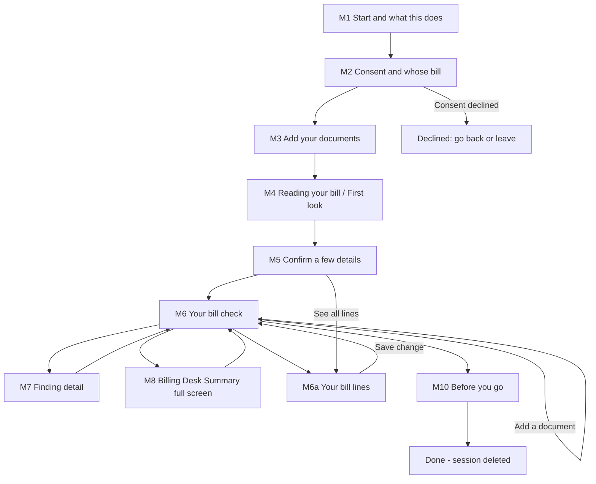

# Interaction Specification — Hospital Bill Check (Project RS, Phase 1)

This document says how the screens in `mockups.md` behave: navigation, timing, state changes, announcements and the key components. Component specifications follow `.claude/knowledge/aidlc-design-agent/component-spec-template.md`. Tokens and the shadcn mapping are in `design-system-mapping.md`. The timing rules in §3 say exactly when the idle timer pauses: only while a server job runs and the user is waiting for it.

## Sources

- [Q1]–[Q12]: answers in `refined-mockups-questions.md` in this folder.
- User stories: `inception/user-stories/stories.md`; US and AC IDs and the stage decisions D-US1 to D-US23 refer to it.
- Requirements: `inception/requirements-analysis/requirements.md`.
- Rough mockups: `ideation/rough-mockups/wireframes.md`, `user-flow.md`.
- Team practices: `inception/practices-discovery/team-practices.md`.

## 1. Navigation model

The product is one linear session, not a site with menus (rough user flow §4). There are at most 2 screens before upload (D-US15), and the report is a single page with in-page links [Q8].



Text version: start → consent → upload → reading and first look → confirm → report. From the report the user can:

- open a finding and return;
- open the Billing Desk Summary full screen and return;
- open "Your bill lines" (M6a, also reachable from the confirm screen) to fix a line;
- add a document.

Fixing a line or adding a document regenerates the report in place, with no return to M4. "Before you go" ends and deletes the session. Declining consent on M2 offers going back or leaving.

### Navigation rules

| Rule | Detail | Story |
|---|---|---|
| Forward only through the gates | M3 is reachable only after M2 is complete; a direct address goes back to M1 | AC1.1.4 |
| Back | The browser back button and an in-page "Back" both work inside the session. No bill data is shown after the session ends, even from the back-forward cache | AC7.1.2 |
| Step indicator | Upload (M3) → Review (M4, M5) → Report (M6–M10) | US3.2 |
| Discard everything | Always in the header from M2 on; opens `DiscardDialog` | US7.3 |
| Start a new check | Only from M10 "Done" and the session-ended state; it ends the old session first | AC7.1.5 |
| No prefetch of bill screens | Links to M4–M10 are not prefetched with bill data | AC7.6.5 |

## 2. Screen-by-story mapping

| Screen | Stories |
|---|---|
| M1 | US1.1, US1.2, US1.3 |
| M2 | US1.4, US1.5, US1.6, US1.7, US9.5 (beta variant) |
| M3 | US2.1, US2.2, US2.3, US2.4, US2.5, US2.6, US2.7, US2.8, US2.9, US2.10, US2.11, US7.5 |
| M4 | US3.2, US3.3, US3.9, US3.8, US3.10, US3.11, US3.12 (processing behind the screen) |
| M5 | US3.1, US3.4, US3.5, US3.6, US3.7 |
| M6 | US4.1–US4.14, US5.1, US5.2, US5.5, US5.10, US6.1, US6.5, US6.7 |
| M6a | US3.5 |
| M7 | US4.9, US4.13, US6.1, US6.4 |
| M8 | US5.3, US6.1 |
| M9 | US5.6, US5.7, US5.8, US5.9, US6.2, US6.3 |
| M10 | US5.4, US5.11, US6.6, US7.1, US7.2 |
| Session-wide | US7.3, US7.4, US7.6, US7.9 |
| PDF | US5.2, US5.3, US5.4, US5.11, US6.2 |
| I1–I4 and described tools | US8.1–US8.5, US9.1–US9.4, US10.1–US10.4 |
| Not on a screen (system behaviour) | US7.7 (3-month deletion), US7.8 (applies to every screen) |

## 3. Timing rules

| Rule | Value | Behaviour | Source |
|---|---|---|---|
| Idle warning | 25:00 without activity | `IdleWarning` opens; "Keep going" resets the timer | FR2.8, AC7.4.1 |
| Session end | 30:00 without activity | Session ended on the server; the next screen shows "Session ended" | AC7.4.3, AC7.4.6 |
| What counts as activity | Taps, clicks, typing, scrolling within the page | Background progress checks never count | D-US13 |
| Timer paused | Only while a server processing job is running and the user is waiting for it: M4 before the first look, and M6 while it shows "Still checking" or "Updating your report…" | On M5, M6a and every other screen where the user is the one being waited on, the idle timer runs normally | D-US13 |
| Pause cap | 15 minutes of server job time per job | Measured from the start of the job, not from the upload. When reached, the job counts as failed, the screen shows "This is taking too long" with [ Try again ], and the idle timer runs again from that moment | [Q1] |
| After "Try again" | A new job with its own 15-minute cap | Between attempts the idle timer runs; a user who walks away times out at 30:00 as normal | [Q1] |
| Progress estimate | Shown in minutes | Replaced by "Taking longer than usual. Still working." once passed | AC3.2.5 |
| Screen usable | Within 4 s on the phone test profile | Every user screen | AC3.2.3 |
| PDF build | "Preparing your report" shown when building takes more than 1 s | The time limit on the test device is set in NFR Requirements | AC5.4.9 |

## 4. Announcements (screen readers)

| Event | Announcement | Politeness |
|---|---|---|
| Upload file finished, failed or paused | "pharmacy-1.jpg uploaded" / "… failed" / "… paused" | polite |
| Processing milestone | "Reading pages done", "Running checks", "Report ready" | polite |
| First look ready | Heading changes to "First look"; "First look ready" | polite |
| Report regenerated | The `ChangeNotice` text | polite |
| Full report ready | "Full report ready" | polite |
| Form error on M2 | The error text of the first missing item | assertive (on submit only) |
| Idle warning | The dialog's title and text | dialog (focus moves) |
| Copy letter | "Letter copied" | polite |

No announcement fires on every progress percentage (AC3.2.6).

## 5. Key flows with error paths

```
Flow: Check a bill at discharge
Persona: C1 Priya (phone)
Trigger: the hospital hands over the final bill
Steps:
  1. M1 -> "Start my check"                   -> M2
  2. M2 -> "My spouse's", under 18: No,
           "The patient has agreed", both
           boxes, "Continue"                  -> M3
  3. M3 -> "At discharge", "Take a photo",
           tips, camera, 3 pages, "Check my
           bill"                              -> M4, timer paused
  4. M4 -> waits; first look appears          -> "Confirm a few details"
  5. M5 -> confirms 1 unclear line            -> M6
  6. M6 -> reads Top 3, opens finding 1, marks
           "Will ask", returns                -> summary updated
  7. M6 -> "Show full screen" on the summary  -> shows it at the desk
  8. M6 -> "Save or share"                    -> phone share menu
  9. M10 -> "No thanks", "Finish"             -> session deleted
Success outcome: Priya leaves with a saved report and 2–3 polite points for the desk
Error paths:
  - Step 2, box unticked -> text error, focus to the box -> tick it
  - Step 3, blurry page -> "Page 2 is blurry" with preview -> retake
  - Step 3, connection drops -> upload paused, resumes when back online
  - Step 4, 15 minutes pass -> "This is taking too long" -> Try again or Discard
  - Step 8, share cancelled -> not counted as saved; reminder on "Finish"
  - Step 5, Priya walks away on M5 -> idle timer runs (no job is running) -> warning at 25:00, session ends at 30:00
  - Step 6, she fixes a wrong amount on M6a -> report shows "Updating your report…" -> ChangeNotice, focus on it
  - Any step after the report, "Discard everything" with no saved copy -> dialog reminds her to save first
  - Any step, 25 minutes idle (after the report) -> warning -> Keep going
```

```
Flow: Check a forwarded bill from abroad
Persona: C2 Meera (desktop)
Trigger: relatives send photos on WhatsApp
Steps:
  1. M1 -> M2 ("My parent's", under 18: No, "The patient has agreed")
  2. M3 -> "Still in hospital", saves the photos from WhatsApp to the
           laptop, drops them in the drop area or "Choose files"
  3. M4 -> M5: one line in Hindi listed as "Could not be read"
  4. M6 desktop: findings list left, detail right; "Download" (the desktop label)
  5. M10 -> "Yes, keep it" -> "Finish"
Error paths:
  - Step 2, 21st file -> "That's more than 20 files. Remove a file to add another."
  - Step 2, a file is not a hospital document -> Remove or Keep
  - Step 4, she adds the discharge summary later -> M4 -> M6 with ChangeNotice
```

```
Flow: Approve a reference-price change
Persona: I1 builder or founder (desktop)
Steps:
  1. I1 sign in -> rule library -> edit RX-02 price -> save
  2. Synthetic test bills re-run automatically
  3. I2 shows 0 unexpected changes -> "Approve" (self-approval logged)
Error paths:
  - Unexpected changes found -> Approve disabled with the list and reason [Q2]
  - Missing source -> Approve disabled, naming the missing field
```

## 6. Component specifications

### ProgressSteps

| Field | Value |
|---|---|
| Component | ProgressSteps |
| Description | Shows where the user is: Upload, Review, Report |
| Category | navigation |

| State | Description | Trigger |
|---|---|---|
| default | Three steps, one current | Screen render |
| complete step | Step shows ✓ and "done" in text | Step finished |

| Prop | Type | Required | Default | Description |
|---|---|---|---|---|
| current | "upload" \| "review" \| "report" | yes | — | Current step |

| Breakpoint | Behaviour |
|---|---|
| < 1024 px | Compact: labels under small markers |
| ≥ 1024 px | Inline labels with connecting lines |

| Requirement | Implementation |
|---|---|
| ARIA role | `<ol>` list; current item has `aria-current="step"` |
| Keyboard interaction | Not interactive |
| Label | `aria-label="Progress"` on the list |
| Screen reader | "Step 2 of 3: Review, current step" (AC3.2.7) |

### ChoiceGroup

| Field | Value |
|---|---|
| Component | ChoiceGroup |
| Description | A single-choice question with a visible legend (whose bill, under 18, when are you checking, plan) |
| Category | input |

| State | Description | Trigger |
|---|---|---|
| default | No option selected | Render |
| focus | Focus ring on the focused option | Tab / arrow keys |
| error | Text message under the legend; group has `aria-invalid` | Continue pressed with no answer |
| disabled | Not used | — |

| Prop | Type | Required | Default | Description |
|---|---|---|---|---|
| legend | string | yes | — | The question |
| options | {value, label}[] | yes | — | Choices in display order |
| value | string | no | none | Selected value; never pre-selected |
| error | string | no | — | Error text |

| Breakpoint | Behaviour |
|---|---|
| < 1024 px | One option per row, each 48 px tall |
| ≥ 1024 px | Same; short groups (No / Yes) inline |

| Requirement | Implementation |
|---|---|
| ARIA role | `radiogroup` (shadcn `RadioGroup`) inside `<fieldset>` with `<legend>` |
| Keyboard interaction | Tab into the group; arrow keys move and select; Tab leaves |
| Label | Each option has a visible label; the group is labelled by the legend |
| Contrast ratio | Border 4.8:1; focus ring 10.4:1 |
| Screen reader | Legend, option label, "1 of 7", selected state; error text via `aria-describedby` |
| Focus management | On a submit error, focus moves to the first unanswered group |

### FileDrop and FileList

| Field | Value |
|---|---|
| Component | FileDrop + FileList |
| Description | Adds files (camera, file picker, drag on desktop) and lists them with status |
| Category | input / feedback |

| State | Description | Trigger |
|---|---|---|
| disabled | Buttons disabled with the reason in text | Stay question unanswered |
| empty | "Start with the hospital bill" | No files yet |
| uploading | Row shows "Uploading n%" | Upload in progress |
| paused | Row shows "Paused — will continue when you're back online" | Connection lost |
| done | Row shows "Done", page count and type | Upload finished |
| error | Row shows the reason and the action (Retake, Remove, Try again, Enter password) | Blurry, not a document, failed, locked |

| Prop | Type | Required | Default | Description |
|---|---|---|---|---|
| enabled | boolean | yes | false | False until the stay question is answered |
| files | FileRow[] | yes | [] | Each with name, pages, type, status, message |
| limits | {files: 20, mbPerFile: 25, pages: 60} | yes | — | Limits from US2.3 |

| Breakpoint | Behaviour |
|---|---|
| < 1024 px | "Take a photo" and "Choose files" buttons; no drop area |
| ≥ 1024 px | Drop area with "Choose files" inside; "Take a photo" hidden |

| Requirement | Implementation |
|---|---|
| ARIA role | Native file input behind a `Button`; list is `<ul>` |
| Keyboard interaction | Every action is a button; dragging is never required (WCAG 2.5.7) |
| Label | "Choose files", "Take a photo"; each row's actions name the file ("Retake page 4") |
| Screen reader | Status changes announced politely at finish, failure or pause only |
| Focus management | After removing a file, focus moves to the next row, or to "Choose files" if the list is empty |

### FindingCard

| Field | Value |
|---|---|
| Component | FindingCard |
| Description | One finding in the list: class, confidence, plain name, amount, who to ask |
| Category | display |

| State | Description | Trigger |
|---|---|---|
| default | Card with coloured left edge and icon | Render |
| hover / focus | Edge thickens; focus ring | Pointer / Tab |
| selected (desktop) | Background tint; `aria-current="true"` | Chosen in the list |
| marked | Small "Will ask" or "Not pursuing" text | User marked it |

| Prop | Type | Required | Default | Description |
|---|---|---|---|---|
| findingClass | "likely" \| "worth" \| "explained" | yes | — | Sets icon, label and colour |
| confidence | "High" \| "Medium" \| "Low" | yes | — | Shown in text |
| name | string | yes | — | Plain-language name (AC4.9.6) |
| amount | paise (integer) | yes | — | Shown as ₹ with Indian grouping |
| route | string | yes | — | One of the four "Who to ask" labels |
| mark | "will" \| "not" \| null | no | null | User's mark |

| Breakpoint | Behaviour |
|---|---|
| < 1024 px | Full width; activating opens M7 as its own view |
| ≥ 1024 px | In the 400 px list; activating fills the detail panel |

| Requirement | Implementation |
|---|---|
| ARIA role | The whole card is one link (phone) or button (desktop) |
| Label | "Likely error, high confidence: Room charged for an extra day, ₹4,000, ask the hospital" |
| Contrast ratio | Label text at least 6.8:1 on its tint; edge at least 4.8:1 |
| Screen reader | The label above; the icon is `aria-hidden` |
| Focus management | Returning from M7 restores focus to the card (AC7.8.9) |

### LowConfidenceGroup

| Field | Value |
|---|---|
| Component | LowConfidenceGroup |
| Description | Collapsed group "Other things you may ask about (n)" holding every low-confidence finding |
| Category | layout |

| State | Description | Trigger |
|---|---|---|
| collapsed | Shows label with count | Default |
| expanded | Shows FindingCards with "Low confidence" in text | Enter, Space or tap |
| empty | Not rendered | No low-confidence findings |

| Requirement | Implementation |
|---|---|
| ARIA role | shadcn `Collapsible`: button with `aria-expanded`, `aria-controls` |
| Keyboard interaction | Enter or Space toggles |
| Screen reader | "Other things you may ask about, 5, collapsed / expanded" (AC4.12.3) |

### BillBreakdown

| Field | Value |
|---|---|
| Component | BillBreakdown |
| Description | Splits the bill total into four parts that add up to the total, to the paisa |
| Category | display |

| State | Description | Trigger |
|---|---|---|
| default | Table of four rows plus a stacked bar | Report ready |
| partial | "Still checking" on rows not yet final | Full check running |
| no findings | Likely error and Worth asking show ₹0 with reassuring text | No findings |

| Requirement | Implementation |
|---|---|
| ARIA role | Native `<table>` with `<caption>` "Bill Breakdown"; the bar is `aria-hidden` |
| Screen reader | Each row read as class, item count, amount |
| Printing | The table prints; the bar is optional |

### DeskSummary (full screen)

| Field | Value |
|---|---|
| Component | DeskSummary |
| Description | The one-page summary for the billing executive, shown as a section and full screen |
| Category | display |

| State | Description | Trigger |
|---|---|---|
| default | "Please correct", then "Please explain" | Report ready |
| nothing marked | Top 3 plus "You can choose which points to raise" | No "Will ask" marks |
| full screen | Summary only, 24 px text, [ Close ] | "Show full screen" |
| offline | Still shows after being opened once | Connection lost |

| Requirement | Implementation |
|---|---|
| ARIA role | `<article>`; full screen is a `Dialog` with `aria-modal="true"` |
| Keyboard interaction | Esc closes full screen; focus is trapped inside while open |
| Focus management | Opens on the h1; Close returns focus to "Show full screen" |

### LetterEditor

| Field | Value |
|---|---|
| Component | LetterEditor |
| Description | An editable letter with Copy and Download; the disclaimer is outside the editable area |
| Category | input |

| State | Description | Trigger |
|---|---|---|
| collapsed | Letter title only | Default |
| open | Textarea with the letter | Title activated |
| copied | "Letter copied" shown and announced | Copy pressed |

| Requirement | Implementation |
|---|---|
| ARIA role | Disclosure button plus labelled `<textarea>` |
| Label | The letter title labels the textarea |
| Focus management | Opening moves focus to the textarea's start |

### IdleWarning

| Field | Value |
|---|---|
| Component | IdleWarning |
| Description | Warns at 25:00 idle that the session will end at 30:00 |
| Category | feedback |

| State | Description | Trigger |
|---|---|---|
| open | Title, minutes left, [ Keep going ] | 25:00 idle |
| closed | — | Keep going, or any activity |
| expired | Replaced by the "Session ended" state | 30:00 idle |

| Requirement | Implementation |
|---|---|
| ARIA role | `alertdialog` (shadcn `AlertDialog`) |
| Keyboard interaction | Focus on "Keep going"; Enter activates; Esc also counts as "Keep going" |
| Screen reader | Title and text read on open; minutes left stated in text |
| Focus management | On close, focus returns to where it was |

### DiscardDialog

| Field | Value |
|---|---|
| Component | DiscardDialog |
| Description | Confirms deleting everything from the check |
| Category | feedback |

| State | Description | Trigger |
|---|---|---|
| no report | "Discard everything from this check?" with [ Discard everything ] [ Cancel ] | Before a report exists |
| report not saved | Adds "You haven't saved your report. Once you discard, it can't be retrieved." and [ Save or share first ] (desktop: [ Download first ]) | Report exists and is unsaved (AC7.1.1) |
| report saved | Adds "Your saved copy stays on your device." | Report saved |

| Requirement | Implementation |
|---|---|
| ARIA role | `alertdialog` |
| Keyboard interaction | Focus starts on "Cancel", or on "Save or share first" when the report is unsaved; Esc cancels |
| Screen reader | "Discard everything from this check? … This can't be undone." with the unsaved-report line when it applies |
| Focus management | Cancel returns focus to the header button; "Discard everything" goes to M1 with "Everything was discarded" |

### ChangeNotice

| Field | Value |
|---|---|
| Component | ChangeNotice |
| Description | Says what changed after a regeneration |
| Category | feedback |

| Requirement | Implementation |
|---|---|
| ARIA role | `role="status"` (polite) |
| Persistence | Stays until the user dismisses it or leaves; never auto-disappears |
| Content | Findings added or removed, the change in the total potentially affected, and any "Will ask" finding that was removed by name |

## 7. Internal-tool interactions

| Screen | Key behaviour | Source |
|---|---|---|
| I1 Sign in | Method per NFR Requirements (R-05); a generic error that never says which part failed; no cognitive test such as a puzzle (WCAG 3.3.8) | US10.2 |
| I2 Approve a rule change | Synthetic test bills re-run on save; "Approve" enabled only with 0 unexpected changes and all of who, what, why and source present; self-approval allowed and logged | [Q2], US8.2 |
| I3 Promote a check | Counts and precision against thresholds; "Make live" enabled only when all pass; boundaries exactly at 10 / 30 / 90.0% pass | US10.1 |
| I4 Withdraw a bill | Lists what is deleted; derived copies pending Domain Design (R-07) | US9.3 |

## 8. Assumptions & Open Questions

- The escalation deadlines shown are illustrative until the reference data is loaded (US8.4).
- Exact durations not yet fixed are set in NFR Requirements: the PDF build limit (AC5.4.9) and the 3-month deletion length (R-06).
- R-04 and R-07 go to Domain Design; R-05 and R-06 go to NFR Requirements [Q3].
- Whether Esc on the idle warning should count as "Keep going" is a design choice made here for keyboard comfort; it can be revisited in testing.
