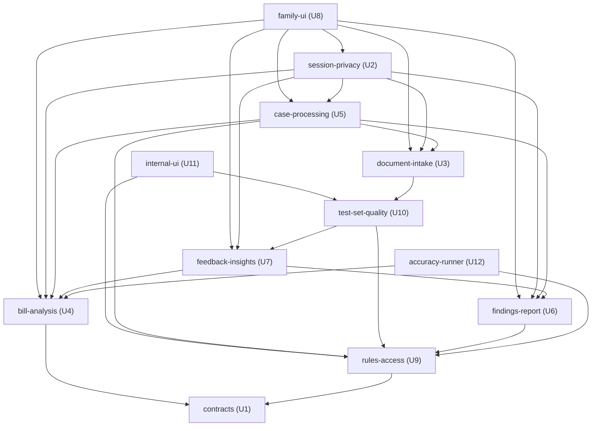

# Unit Dependencies — Hospital Bill Check (Phase 1)

This document is the dependency map between the 12 units in `unit-of-work.md`. "A depends on B" means A calls B's interface or uses B's types. The map shows only what can depend on what. It does not choose a build order or name a critical path; Delivery Planning chooses the order using this map.

Unit-level edges come from the component calls in `inception/domain-design/components.md`, after grouping blocks into units. There is one change from that catalogue: TestSetQuality's accuracy run moved to accuracy-runner (D-UG6 in `unit-of-work.md`), so test-set-quality no longer calls bill-analysis.

## Sources

- `unit-of-work.md` in this folder (units, kinds and decisions D-UG1 to D-UG8).
- Component calls: `inception/domain-design/components.md` (the `depends_on` lists) and `inception/domain-design/decisions.md` (ADR-002 deletion fan-out, ADR-003 coordinator, ADR-004 screen routes, ADR-014 beta hand-over).
- Requirements `inception/requirements-analysis/requirements.md` and stories `inception/user-stories/stories.md`, for the reasons behind each integration point.

## Dependency Edge Block

```yaml
units:
  - name: contracts
    kind: spec
    depends_on: []
  - name: bill-analysis
    kind: library
    depends_on: [contracts]
  - name: rules-access
    kind: service
    depends_on: [contracts]
  - name: findings-report
    kind: library
    depends_on: [contracts, rules-access]
  - name: feedback-insights
    kind: service
    depends_on: [contracts, bill-analysis, findings-report]
  - name: test-set-quality
    kind: service
    depends_on: [contracts, rules-access, feedback-insights]
  - name: document-intake
    kind: service
    depends_on: [contracts, test-set-quality]
  - name: case-processing
    kind: service
    depends_on: [contracts, document-intake, bill-analysis, findings-report, rules-access]
  - name: session-privacy
    kind: service
    depends_on: [contracts, case-processing, document-intake, bill-analysis, findings-report, feedback-insights]
  - name: family-ui
    kind: ui
    depends_on: [contracts, session-privacy, document-intake, case-processing, bill-analysis, findings-report, feedback-insights]
  - name: internal-ui
    kind: ui
    depends_on: [contracts, rules-access, test-set-quality]
  - name: accuracy-runner
    kind: packaging
    depends_on: [contracts, bill-analysis, rules-access]
```

The graph has no loops; this was checked by walking every unit's dependencies. Every unit depends on contracts, which depends on nothing.

## Dependency Diagram



Text fallback: family-ui depends on session-privacy, document-intake, case-processing, bill-analysis, findings-report and feedback-insights. internal-ui depends on rules-access and test-set-quality. session-privacy depends on case-processing, document-intake, bill-analysis, findings-report and feedback-insights. case-processing depends on document-intake, bill-analysis, findings-report and rules-access. document-intake depends on test-set-quality. test-set-quality depends on rules-access and feedback-insights. feedback-insights depends on bill-analysis and findings-report. findings-report depends on rules-access. accuracy-runner depends on bill-analysis and rules-access. Every unit depends on contracts; to keep the diagram readable, only bill-analysis and rules-access draw that edge.

## Integration Points

All calls are in-process through each unit's module interface (D-UG5). The background worker runs the same code. Contract Design defines each interface.

| From | To | What crosses the boundary | Why |
|---|---|---|---|
| every unit | contracts | Shared types and interface signatures, incl. "delete session data" and the bill-reader adapter | Q5; R-05 |
| family-ui | session-privacy | Resolve the session and gates; record consent and declarations; keep alive; discard | ADR-004; FR1, FR2.8 |
| family-ui | document-intake | Files, the "When are you checking?" answer; checklist and page prompts back | FR4 |
| family-ui | case-processing | Start, progress, retry; every change (confirmed details, fixed lines, added documents) | ADR-003; FR4.11, FR5.8 |
| family-ui | bill-analysis | Read the case, lines and items to confirm, for display | FR3.2, FR5.7, FR5.8 |
| family-ui | findings-report | First look, findings, report content; Will ask / Not pursuing marks; letters on request | FR7.5, FR8 to FR11 |
| family-ui | feedback-insights | Ratings, the plan answer, the Insurance Check click | FR12 |
| internal-ui | rules-access | Sign-in and role check; edit, approve, switch shadow/off | FR14, FR15.2 |
| internal-ui | test-set-quality | Add, label, reconcile, withdraw; import accuracy results; promote; dashboard | FR15, FR16 |
| session-privacy | case-processing | Is a report being prepared (idle timer); cancel; delete jobs | D-US13; AC3.9.2; ADR-002 |
| session-privacy | document-intake, bill-analysis, findings-report, feedback-insights | Delete this session's data, with confirmation | ADR-002; FR1.8, FR2.3, FR2.4 |
| session-privacy | feedback-insights | Store a de-identified record at close when storage consent is yes; a failure is dropped with an alert | US7.2; R-02 |
| case-processing | document-intake | Pages to process; page quality; release originals | FR2.3, FR4.6, FR4.7 |
| case-processing | bill-analysis | Extract, build the bill model, apply fixes, run checks, with the pinned rule snapshot passed in | ADR-003, ADR-006; R-01 |
| case-processing | findings-report | Build findings and report content, with the pinned snapshot | FR8.12 to FR10; R-01 |
| case-processing | rules-access | Pin the rule-library and reference-data versions; read the snapshot | FR8.17; NFR6 |
| document-intake | test-set-quality | Closed beta only: hand over a beta original; a failure still deletes it | ADR-014; FR2.11; R-03 |
| test-set-quality | rules-access | Set a check live with its promotion record; read rule versions; log access | ADR-006, ADR-012 |
| test-set-quality | feedback-insights | Grouped ratings from consented records, for the dashboard | FR15.4, FR12.3 |
| feedback-insights | bill-analysis, findings-report | Read the case, lines, clinical summary and findings to build the consented record | FR2.5, FR2.6 |
| findings-report | rules-access | Grievance timelines at the pinned version, for the escalation ladder | FR9.7 |
| accuracy-runner | bill-analysis | Read test bills through the adapter; run checks on labelled data | NFR4, NFR16 |
| accuracy-runner | rules-access | Load a rule snapshot exported from the library | FR16.12 |
| accuracy-runner → test-set-quality | (file, not a call) | An output file of bill IDs and scores, imported through the internal tools | D-UG6; ADR-009 |

## Parallel Development Opportunities

Units with no dependency path between them, in either direction, can be designed and built in parallel (D-UG7). These are the independent groups the map allows. This is not a recommended order.

| Unit | Independent of |
|---|---|
| bill-analysis | rules-access, findings-report |
| rules-access | bill-analysis |
| findings-report | bill-analysis, accuracy-runner |
| feedback-insights | accuracy-runner |
| test-set-quality | accuracy-runner |
| document-intake | internal-ui, accuracy-runner |
| case-processing | internal-ui, accuracy-runner |
| session-privacy | internal-ui, accuracy-runner |
| family-ui | internal-ui, accuracy-runner |
| internal-ui | document-intake, case-processing, session-privacy, family-ui, accuracy-runner |
| accuracy-runner | findings-report, feedback-insights, test-set-quality, document-intake, case-processing, session-privacy, family-ui, internal-ui |
| contracts | none (every unit depends on it) |

So the map allows several different valid orders. For example, the family side (document-intake, case-processing, session-privacy, family-ui) and the internal screens (internal-ui) do not depend on each other. accuracy-runner depends on bill-analysis and rules-access, and on nothing else.

## Assumptions & Open Questions

- Because units share one codebase and call in-process, a dependency here is a code-level import. Contract Design should keep each unit's interface to the operations listed above.
- document-intake's dependency on test-set-quality exists only for the closed beta (ADR-014). It is removed at launch together with the beta hand-over, and that removal does not change any other edge.
